# Ashrafi Khan Pathan — Portfolio Website: Complete Reference

> **How to use this document:** This single file fully describes a personal portfolio website: its purpose, content, structure, design system, behavior, and the **complete, unmodified source code** of every code file (Part 2). Part 1 is an explanation written to make the code easy to understand. If Part 1 and the source code ever disagree, **the source code in Part 2 is the source of truth**. Binary files (images, PDF) can't be embedded in text, so they're described in section 3 instead.

**Snapshot:** commit `9c8fa3a` of the `main` branch, generated 2026-10-03.

---

# Part 1 — Explanation

## 1. Project overview

| Item | Value |
|---|---|
| What it is | A single-page personal portfolio website for a WordPress developer |
| Owner | Ashrafi Khan Pathan — WordPress Developer, Gujarat, India |
| Current role | WordPress Developer (work from home) at MadeByAura, March 2024 – present |
| Live URL | https://ashrafikhan.github.io/Portfolio/ |
| Source repository | https://github.com/AshrafiKhan/Portfolio (branch `main`) |
| Hosting | GitHub Pages, deployed automatically from `main` |
| Build step | None. Plain static files; open `index.html` directly or serve the folder with any static server |
| Contact shown on site | Email `pathanashrafi2709@gmail.com`, GitHub `AshrafiKhan`, LinkedIn `ashrafi-khan-pathan-2824891b2` |

**Goal of the site:** present the owner as a WordPress developer who builds fast, responsive, SEO-friendly websites (Figma-to-WordPress, Elementor Pro, ACF, WooCommerce), show real client work with responsive screenshots at four screen sizes, and get visitors to make contact or download the resume.

## 2. Tech stack

- **HTML5**: one page, `index.html`, with semantic landmarks (`nav`, `header`, `main`, `section`, `article`, `footer`, `dialog`).
- **CSS3**: one stylesheet, `style.css`, built on CSS custom properties (design tokens) with two themes. No preprocessor, no framework.
- **Vanilla JavaScript**: one script, `script.js`, plus a tiny inline script in `<head>`. No libraries, no frameworks, no bundler.
- **Fonts (Google Fonts)**: Space Grotesk 600/700 (display headings), Inter 400 (body), JetBrains Mono 400/600 (labels, buttons, code).
- **SEO**: meta description, canonical URL, Open Graph and Twitter card tags with a 1200×630 preview image, and schema.org `Person` JSON-LD.

## 3. File structure

```text
.
├── index.html                 # The whole page: markup, content, meta tags, JSON-LD, inline theme bootstrap
├── style.css                  # All styles: theme tokens, shared "blueprint" design system, components, responsive rules
├── script.js                  # All behavior: nav, reveals, counters, tilt, intro screen, theme toggle, gallery switcher, lightbox, nav scroll
├── favicon.svg                # "AK" monogram icon
├── og-image.png               # 1200×630 social preview image (binary, described below)
├── Ashrafi_Pathan_Resume.pdf    # Downloadable resume (binary, described below)
├── README.md                  # Short project readme
└── images/                    # 12 project screenshots (binary, described below)
```

### Binary assets (not embedded)

| File(s) | Description |
|---|---|
| `og-image.png` | 1200×630 PNG used for link previews. Dark background with a faint grid; text: "GUJARAT, INDIA", "Ashrafi Khan Pathan", "WordPress Developer", "Figma-to-WordPress · Elementor Pro · ACF · WooCommerce", "ashrafikhan.github.io/Portfolio". |
| `Ashrafi_Pathan_Resume.pdf` | Two-page text resume, downloaded by the "Download Resume" buttons. Contents mirror the site: summary, skills, experience, certifications, project highlights, education, languages. |
| `images/<project>-<viewport>.jpg` | Above-the-fold homepage screenshots of the three featured client sites, captured from the live sites. `<project>` is `home-matters`, `new-york-bagel` or `frangrowth`. `<viewport>` and pixel sizes: `desktop` 1600×900 (captured at 1920×1080, downscaled), `laptop` 1366×768, `tablet` 768×1024, `mobile` 780×1688 (390×844 viewport at 2× pixel density). JPEG quality 80, roughly 78–189 KB each. |

## 4. Page structure and content (top to bottom)

| # | Element / id | What it contains |
|---|---|---|
| 0 | `#loadScreen` | Intro overlay, first visit per browser session only: "SCOUTER ONLINE" label, a number counting up to a random 8,000–8,899 "power level", then "IT'S OVER INFINITY!", then it fades out (about 2s total). Dragon Ball reference. |
| 1 | `nav` | Fixed top bar: logo "AK.Pathan"; links About, Services, Skills, Projects, Experience, Contact; theme toggle switch; hamburger button (phones). |
| 2 | `header.hero` | Eyebrow "Gujarat, India"; `h1` "Ashrafi Khan **Pathan**" (surname in accent color); tagline "WordPress Developer Building Fast, Scalable & SEO-Friendly Websites"; summary paragraph; buttons **View My Work** (→ `#projects`), **Let's Talk** (→ `#contact`), **Download Resume** (PDF); check-mark trust line (2.5+ Years Experience, 10+ Websites Built, 15+ Websites Maintained, Remote Agency Experience). Right side: a code-editor style card showing a `const dev = {...}` object, with two floating labels "Elementor Pro" and "40% faster loads"; it tilts in 3D with the mouse on desktop. |
| 3 | `.proof-banner` | Five highlight cards: 2.5+ Years Experience · 10+ Websites Built · 15+ Websites Maintained · Remote Agency Experience · Elementor + ACF Specialist. |
| 4 | `#about` | Two paragraphs of profile text plus four stat cards (2.5+ years, 10+ sites built, 15+ sites maintained, 40% average speed gain) that count up when scrolled into view. |
| 5 | `#services` | Three numbered cards: 01 WordPress Development, 02 Website Optimization, 03 Content Management Systems. |
| 6 | `#skills` | Five cards of skill chips: WordPress Development (Elementor Pro, ACF, WooCommerce, Custom Post Types); Frontend Development (HTML, CSS, JavaScript, Bootstrap, Tailwind CSS); Backend & Database (PHP, MySQL); Optimization & SEO (Performance Optimization, Technical SEO, Responsive Design); Tools (Git, ChatGPT, Claude Code, Gemini). |
| 7 | `#projects` "Featured Projects" | Three large case-study cards, each with: a **responsive screenshot gallery** (desktop, laptop, tablet, mobile), project name, **View Live Website** button (new tab), and three columns **Challenge / My Contribution / Impact**. Projects: **Home Matters** (https://homematters.com/), **New York Bagel Co.** (https://newyorkbagel.com/), **FranGrowth** (https://frangrowth.com/). |
| 8 | `#experience` | Vertical timeline of three roles: WordPress Developer (WFH) at MadeByAura (March 2024 – Present); Web Development Training at ConicPlex (Oct 2023 – Dec 2023); Web Developer Intern at HATKESH InfoTech Pvt. Ltd. (Dec 2022 – May 2023). |
| 9 | `#certifications` | Six certification rows, newest first (Feb 2024 to Sep 2023): Udemy courses and AT&T E-Learning UI/UX Basic. |
| 10 | `#education` | B.Tech in Computer Engineering, BVM Engineering College, Gujarat, completed 2025; Languages: English, Hindi, Gujarati. |
| 11 | `#contact` | Card: "Need Help With Your WordPress Website?", short pitch, buttons **Email Me** (mailto), **View LinkedIn** (new tab), **Download Resume**. |
| 12 | `footer` | "Designed & built by Ashrafi Khan Pathan · Gujarat, India". |
| 13 | `dialog#lightbox` | Full-screen screenshot viewer (hidden until a gallery screenshot is clicked). |

Fixed decorative layers behind the content: `.grid-glow` (full-page construction grid), `.noise` (subtle film-grain texture), and `.kame-wave` (a horizontal light beam shown only while a nav link scrolls the page).

## 5. Design system

The visual concept is a **drafting / blueprint** aesthetic shared by both themes: a full-page construction grid, solid cards with hairline borders and a **blue offset shadow** (like slightly misregistered print), a blueprint-blue primary button with a **hard solid shadow**, monospace labels prefixed with `//`, and fairly tight corners. The two themes differ **only in color tokens**.

### 5.1 Themes

| | **Graphite night** (dark) | **Blueprint paper** (light) |
|---|---|---|
| When active | Default (no class on `<html>`) | `<html class="light-mode">` |
| Feel | Charcoal drafting desk at night | Warm drafting paper |
| Page background `--bg` | `#111316` | `#f4f1ea` |
| Card surface `--paper` / `--panel` | `#181a1f` | `#fffdf8` |
| Text `--text` | `#eceef2` | `#14161a` |
| Dim text `--text-dim` | `#b3b7c0` | `#43464e` |
| Faint text `--text-faint` | `#8b909a` | `#62656d` |
| Accent (text, markers) `--accent` | `#8aa4ff` | `#1f4fd8` |
| Secondary accent `--accent-2` | `#a3b1d9` | `#3a5597` |
| Primary button fill `--accent-fill` | `#4766e8` | `#1f4fd8` |
| Grid color `--bp-rgb` | `107,140,255` | `31,79,216` |
| Grid line opacity (major / minor) | 0.07 / 0.03 | 0.13 / 0.055 |
| Card shadow | `3px 3px 0` blue at 14% (hover `6px 6px 0` at 30%) | `3px 3px 0` blue at 12% (hover `6px 6px 0` at 24%) |

All text colors meet WCAG AA contrast (≥ 4.5:1) on both the page background and cards in both themes.

**Theme selection logic:** an inline script in `<head>` runs before first paint. It adds `light-mode` if `localStorage.theme === "light"`, or if nothing is saved and the OS prefers a light color scheme. Otherwise dark is used. The toggle button saves the choice to `localStorage.theme` (`"light"` or `"dark"`). Until the visitor chooses, the site follows OS theme changes live. Switching plays a brief white flash-cut transition, skipped if reduced motion is preferred.

### 5.2 How the CSS is organized (`style.css`)

1. **`:root`**: Graphite night tokens (the default) plus shared tokens: fonts, `--radius: 10px`.
2. **`html.light-mode`**: Blueprint paper token overrides (colors only).
3. **Shared blueprint system**: rules prefixed with `html` (e.g. `html .btn.primary`) so they out-rank the component defaults that come later. Covers solid cards (no frosted blur), button styles, skill chips, the hero code card as a "technical sheet", the contact card, the `//` label prefix, and the blue nav-scroll wave.
4. **Base and layout**: reset, body, grid and noise layers, `.wrap` container (max-width 1120px).
5. **Components in page order**: nav, hero, buttons, hero code card, sections and reveal animations, about/stats, skills, proof banner, services, featured projects (device gallery, mobile device switcher, lightbox), timeline, certifications, education, contact, footer, loading screen, nav scroll wave.
6. **Global media rules**: reduced motion, the `paused` class, focus styles, and small-screen tweaks.

Naming note: some class names predate the current design and are kept for stability. For example, `.glass-card` is now a solid "technical sheet" card, not frosted glass, and `.grid-glow` is the full-page grid layer.

### 5.3 Typography

- Display headings (`h1`, section titles, card titles): Space Grotesk 700 (600 for the tagline and timeline roles). The `h1` uses `clamp(2.4rem, 5.2vw, 3.6rem)`.
- Body: Inter 400, line-height 1.6.
- Labels, nav links, buttons, dates, chips, code: JetBrains Mono.
- Section labels ("eyebrows") are uppercase monospace with a `// ` prefix.

### 5.4 Layout and breakpoints (all `max-width`)

960px (proof banner 5→3 columns) · 860px (hero becomes one column, the hero card stops tilting, services and project columns stack) · 780px (about and skills grids collapse) · **720px** (hamburger menu; featured-project galleries switch to the tab switcher) · 700px (certifications and education stack) · 640px (tighter padding; hero and contact buttons stack full-width) · 560px (proof banner becomes 2 columns) · 520px / 480px (small type and spacing tweaks).

### 5.5 Featured-project gallery design

- **Wider than 720px**: a bottom-aligned lineup of four device frames (desktop, laptop with a base, tablet, phone), sized by grid ratios `4.5fr 3.6fr 1.7fr 1fr` so the frames have similar heights. Each frame is labeled, e.g. "Tablet · 768px".
- **720px or narrower (with JavaScript)**: one device shown at a time, plus a segmented tab bar **Desktop · Laptop · Tablet · Mobile** with icons. Tap a tab or swipe left/right on the preview to switch, with a fade-and-slide transition. There's no horizontal scrolling.
- **720px or narrower (without JavaScript)**: a 2×2 grid of all four devices.
- **Any width**: clicking a device opens the lightbox. Without JavaScript the link opens the image file directly.

### 5.6 Motion

Only purposeful motion remains: scroll-reveal fade-ups (each element once, with staggered children in grids), count-up stats (once), hover lift and subtle 3D tilt on cards (mouse devices only), hero card 3D tilt (desktop), the first-visit intro screen, the nav-scroll wave, gallery switch transitions, and the theme flash. There are no endlessly looping decorative animations. Everything respects `prefers-reduced-motion: reduce` (animations and transitions are disabled, and the intro and wave are skipped), and CSS animations pause while the tab is hidden.

## 6. JavaScript behavior (`script.js`, plus the inline `<head>` script)

| Feature | What it does |
|---|---|
| Inline head bootstrap | Adds `html.js` (enables JS-only styles), applies `light-mode` from saved or OS preference, and adds `no-intro` if the intro was already shown this session. Runs before the first render, so there's no theme flash. |
| Tab visibility | Toggles `html.paused` on `visibilitychange`, which pauses CSS animations. |
| Mobile nav | The hamburger toggles `.open` on the menu and button and keeps `aria-expanded` in sync. The menu closes when a link is clicked or Escape is pressed (focus returns to the button). Closed links are `visibility: hidden`, so they can't be reached with Tab. |
| Stat count-up | An IntersectionObserver (threshold 0.4) animates `.stat-num` from 0 to `data-target` (with `data-suffix`) over 1.4s, once. The HTML already contains the final values for no-JS visitors and crawlers. |
| Scroll reveal | An IntersectionObserver (threshold 0.15) adds `.in` to `.reveal` elements, once. Hidden-until-revealed styles only apply under `html.js`. |
| Hero card tilt | On viewports wider than 860px, mouse position over the hero card area rotates the card in 3D. |
| Card tilt | On hover-capable devices, cards tilt slightly toward the cursor. |
| Intro screen | Plays the "power level" count-up only on the first visit per session (`sessionStorage.introSeen`). It has a 2.5s safety timeout, and a CSS fallback auto-hides it after 4s if `script.js` never loads. |
| Theme toggle | Toggles `light-mode`, saves the choice, keeps `aria-pressed` in sync, follows OS changes until the visitor picks a theme, and plays the flash-cut transition. |
| Device switcher | For each `.device-gallery`, builds a tab bar (`role="tablist"`) with SVG icons, wraps it with the gallery in `.device-showcase`, and supports clicking, Left/Right arrow keys and horizontal swipes. CSS shows this only at 720px or narrower. |
| Lightbox | Uses a native `<dialog>`. Clicking a device link opens that screenshot; prev/next buttons and Left/Right keys cycle within the same project; Escape, the × button or clicking the backdrop closes it, and focus returns to the clicked thumbnail. |
| Nav scroll ("Kamehameha wave") | Same-page `#` links scroll with a custom eased animation (450–1200ms) while a horizontal light beam sweeps down the screen. It updates the URL hash with `history.pushState`, moves focus to the target section, and offsets for the fixed nav. Uses `behavior: 'instant'` per frame so it doesn't fight the CSS `scroll-behavior: smooth`. |

### State keys and classes

- `localStorage.theme`: `"light"` or `"dark"` (the visitor's explicit choice).
- `sessionStorage.introSeen`: `"1"` after the intro has played this session.
- Classes on `<html>`: `js` (JavaScript running), `light-mode` (light theme), `no-intro` (skip intro), `paused` (tab hidden).
- Classes set by JS on elements: `.in` (revealed), `.open` (mobile menu), `.is-active` (current device in the switcher), `.hide` (intro fading out), `.active` (nav wave visible), `.over` (intro reached "over infinity").

## 7. Accessibility

- Semantic landmarks and a logical heading order (`h1` = name, `h2` per section, `h3`/`h4` inside cards).
- All interactive controls are real `<a>` or `<button>` elements with labels (`aria-label`, `aria-expanded`, `aria-pressed`, `aria-controls`); the gallery tab bar uses `role="tablist"`/`role="tab"` with `aria-selected` and roving `tabindex`.
- Visible `:focus-visible` outlines; focus is managed after nav scrolling and lightbox close.
- "View Live Website" links include visually hidden "(opens in a new tab)" text.
- All screenshots have descriptive `alt` text; decorative layers are `aria-hidden="true"`.
- Content is fully visible without JavaScript (reveal and intro styles are gated by `html.js`).
- Respects `prefers-reduced-motion`.
- Text contrast meets WCAG AA in both themes.

## 8. SEO and sharing

- `<title>`: "Ashrafi Khan Pathan — WordPress Developer"; meta description; author; canonical `https://ashrafikhan.github.io/Portfolio/`.
- Open Graph: title, description, type `website`, url, image `og-image.png` (1200×630, with width, height and alt).
- Twitter: `summary_large_image` card with title, description and image.
- JSON-LD `Person`: name, jobTitle, url, email, address (Gujarat, IN), worksFor (MadeByAura), alumniOf (BVM Engineering College), knowsAbout, sameAs (GitHub, LinkedIn).

## 9. Conventions for making changes

- **Colors**: change tokens in `:root` (dark) and/or `html.light-mode` (light) at the top of `style.css`. Avoid hard-coded colors in components.
- **Shared look**: put rules that must beat component defaults in the "Shared blueprint system" block, using the `html ` prefix.
- **Stats**: in `#about`, set both the visible text and `data-target` / `data-suffix` on each `.stat-num`.
- **Adding a featured project**: copy one `<article class="feat-card reveal">` block. Add four screenshots named `images/<slug>-desktop.jpg`, `-laptop.jpg`, `-tablet.jpg`, `-mobile.jpg` at the sizes listed in section 3, and keep the `width`/`height` attributes matching the image sizes. The device switcher and lightbox pick up new galleries automatically.
- **Navigation**: nav links are same-page anchors (`href="#id"`), and any `a[href^="#"]` automatically gets the animated scroll.
- **No build step**: edit the files and refresh. Deploy by pushing to `main` (GitHub Pages).

## 10. Known notes

- Screenshots are static captures of the client sites' homepages; they don't update if those sites change.
- A code comment in `script.js` still describes the theme toggle as "grayscale light/dark". That wording is outdated; both themes now use the blueprint-blue accent.
- The Dragon Ball references (the "Scouter" intro and the "Kamehameha" scroll wave) are intentional easter eggs.

---

# Part 2 — Complete source code

Each file below is reproduced exactly as it is in the repository.

## `index.html`

```html
<!doctype html>
<html lang="en">
  <head>
    <meta charset="UTF-8" />
    <meta name="viewport" content="width=device-width, initial-scale=1.0" />
    <title>Ashrafi Khan Pathan — WordPress Developer</title>
    <meta
      name="description"
      content="Ashrafi Khan Pathan is a WordPress Developer in Gujarat, India specializing in Figma-to-WordPress builds, Elementor Pro, ACF, WooCommerce, SEO-friendly structure, and performance-focused websites."
    />
    <meta name="author" content="Ashrafi Khan Pathan" />
    <link rel="canonical" href="https://ashrafikhan.github.io/Portfolio/" />
    <meta
      property="og:title"
      content="Ashrafi Khan Pathan — WordPress Developer"
    />
    <meta
      property="og:description"
      content="WordPress Developer specializing in fast, responsive, SEO-friendly Figma-to-WordPress websites with Elementor Pro, ACF, and WooCommerce."
    />
    <meta property="og:type" content="website" />
    <meta property="og:url" content="https://ashrafikhan.github.io/Portfolio/" />
    <meta
      property="og:image"
      content="https://ashrafikhan.github.io/Portfolio/og-image.png"
    />
    <meta property="og:image:width" content="1200" />
    <meta property="og:image:height" content="630" />
    <meta
      property="og:image:alt"
      content="Ashrafi Khan Pathan — WordPress Developer"
    />
    <meta name="twitter:card" content="summary_large_image" />
    <meta
      name="twitter:title"
      content="Ashrafi Khan Pathan — WordPress Developer"
    />
    <meta
      name="twitter:description"
      content="WordPress Developer specializing in fast, responsive, SEO-friendly Figma-to-WordPress websites."
    />
    <meta
      name="twitter:image"
      content="https://ashrafikhan.github.io/Portfolio/og-image.png"
    />
    <link rel="icon" type="image/svg+xml" href="favicon.svg" />
    <script type="application/ld+json">
      {
        "@context": "https://schema.org",
        "@type": "Person",
        "name": "Ashrafi Khan Pathan",
        "jobTitle": "WordPress Developer",
        "url": "https://ashrafikhan.github.io/Portfolio/",
        "email": "mailto:pathanashrafi2709@gmail.com",
        "address": {
          "@type": "PostalAddress",
          "addressRegion": "Gujarat",
          "addressCountry": "IN"
        },
        "worksFor": { "@type": "Organization", "name": "MadeByAura" },
        "alumniOf": {
          "@type": "CollegeOrUniversity",
          "name": "BVM Engineering College"
        },
        "knowsAbout": [
          "WordPress",
          "Elementor Pro",
          "Advanced Custom Fields",
          "WooCommerce",
          "PHP",
          "SEO",
          "Web Performance"
        ],
        "sameAs": [
          "https://github.com/AshrafiKhan",
          "https://www.linkedin.com/in/ashrafi-khan-pathan-2824891b2"
        ]
      }
    </script>
    <script>
      (function () {
        var root = document.documentElement;
        root.classList.add("js");
        try {
          var saved = localStorage.getItem("theme");
          if (
            saved === "light" ||
            (!saved &&
              window.matchMedia("(prefers-color-scheme: light)").matches)
          ) {
            root.classList.add("light-mode");
          }
        } catch (e) {}
        try {
          if (sessionStorage.getItem("introSeen") === "1") {
            root.classList.add("no-intro");
          }
        } catch (e) {}
      })();
    </script>
    <link rel="preconnect" href="https://fonts.googleapis.com" />
    <link rel="preconnect" href="https://fonts.gstatic.com" crossorigin />
    <link
      href="https://fonts.googleapis.com/css2?family=Space+Grotesk:wght@600;700&family=Inter:wght@400&family=JetBrains+Mono:wght@400;600&display=swap"
      rel="stylesheet"
    />
    <link rel="stylesheet" href="style.css" />
  </head>
  <body>
    <div class="load-screen" id="loadScreen" aria-hidden="true">
      <div class="load-orb"></div>
      <div class="load-label">SCOUTER ONLINE</div>
      <div class="load-power"><span id="loadPowerNum">0</span></div>
      <div class="load-bar">
        <div class="load-bar-fill" id="loadBarFill"></div>
      </div>
    </div>

    <div class="kame-wave" id="kameWave" aria-hidden="true"></div>

    <div class="noise" aria-hidden="true"></div>
    <div class="grid-glow" aria-hidden="true"></div>

    <nav>
      <div class="wrap">
        <div class="logo">AK<span>.</span>Pathan</div>
        <div class="navlinks" id="navlinks">
          <a href="#about">About</a>
          <a href="#services">Services</a>
          <a href="#skills">Skills</a>
          <a href="#projects">Projects</a>
          <a href="#experience">Experience</a>
          <a href="#contact">Contact</a>
        </div>
        <div class="nav-actions">
          <button
            class="theme-toggle"
            id="themeToggle"
            aria-label="Toggle light and dark theme"
            aria-pressed="false"
          >
            <span class="knob"></span>
          </button>
          <button
            class="nav-toggle"
            id="navToggle"
            aria-label="Toggle menu"
            aria-expanded="false"
            aria-controls="navlinks"
          >
            <span></span><span></span><span></span>
          </button>
        </div>
      </div>
    </nav>

    <header class="hero">
      <div class="wrap hero-inner">
        <div>
          <div class="eyebrow">Gujarat, India</div>
          <h1 class="name">
            Ashrafi Khan<br /><span class="grad">Pathan</span>
          </h1>
          <p class="hero-tagline">
            WordPress Developer Building Fast, Scalable &amp;
            <span class="nowrap">SEO-Friendly</span> Websites
          </p>
          <p class="summary">
            2.5+ years of experience developing and maintaining WordPress
            websites using Elementor, ACF, WooCommerce, and custom solutions.
            Built 10+ websites and maintained 15+ live websites for agencies
            and businesses.
          </p>
          <div class="cta-row">
            <a class="btn primary" href="#projects">View My Work</a>
            <a class="btn" href="#contact">Let's Talk</a>
            <a class="btn" href="Ashrafi_Pathan_Resume.pdf" download>Download Resume</a>
          </div>
          <ul class="trust-line">
            <li>2.5+ Years Experience</li>
            <li>10+ Websites Built</li>
            <li>15+ Websites Maintained</li>
            <li>Remote Agency Experience</li>
          </ul>
        </div>

        <div class="stage">
          <div class="glass-card" id="tiltCard">
            <div class="float-chip c1">Elementor Pro</div>
            <div class="float-chip c2">40% faster loads</div>
            <div class="glass-inner">
              <div class="bar">
                <span class="dot"></span><span class="dot"></span
                ><span class="dot"></span>
                <span class="url">ashrafikhan.github.io</span>
              </div>
              <div class="code">
                <div><span class="ln">01</span><span class="kw">const</span> dev = {</div>
                <div><span class="ln">02</span>  role: <span class="str">"WordPress Developer"</span>,</div>
                <div><span class="ln">03</span>  stack: [<span class="str">"Elementor"</span>, <span class="str">"ACF"</span>, <span class="str">"WooCommerce"</span>],</div>
                <div><span class="ln">04</span>  sitesLive: <span class="fn">15</span>,</div>
                <div><span class="ln">05</span>  loadSpeed: <span class="fn">"+40%"</span>, <span class="cmt">// optimized</span></div>
                <div><span class="ln">06</span>  status: <span class="str">"open to opportunities"</span></div>
                <div><span class="ln">07</span>};</div>
              </div>
            </div>
          </div>
        </div>
      </div>
    </header>

    <main class="wrap">
      <ul class="proof-banner reveal" aria-label="Highlights">
        <li class="proof-card">
          <span class="proof-num">2.5+</span
          ><span class="proof-label">Years Experience</span>
        </li>
        <li class="proof-card">
          <span class="proof-num">10+</span
          ><span class="proof-label">Websites Built</span>
        </li>
        <li class="proof-card">
          <span class="proof-num">15+</span
          ><span class="proof-label">Websites Maintained</span>
        </li>
        <li class="proof-card">
          <span class="proof-num">Remote</span
          ><span class="proof-label">Agency Experience</span>
        </li>
        <li class="proof-card">
          <span class="proof-num">Elementor + ACF</span
          ><span class="proof-label">Specialist</span>
        </li>
      </ul>

      <section id="about">
        <div class="sec-head reveal">
          <div class="sec-eyebrow">Profile</div>
          <h2 class="sec-title">About</h2>
        </div>
        <div class="about-grid reveal">
          <div class="about-text">
            <p>
              WordPress Developer with 2.5+ years of hands-on experience working
              with agencies and remote teams, specialized in pixel-perfect
              Figma-to-WordPress conversion, responsive development, and
              SEO-first, performance-optimized websites.
            </p>
            <p>
              Proven ability to manage and maintain multiple live websites,
              collaborate with designers, and deliver reliable results in WFH
              environments — actively integrating AI tools like Claude Code,
              ChatGPT, and Gemini into daily development for faster debugging
              and smarter code review.
            </p>
          </div>
          <div class="stat-grid">
            <div class="stat-card">
              <div class="stat-num" data-target="2.5" data-suffix="+">2.5+</div>
              <div class="stat-label">Years Experience</div>
            </div>
            <div class="stat-card">
              <div class="stat-num" data-target="10" data-suffix="+">10+</div>
              <div class="stat-label">Sites Built</div>
            </div>
            <div class="stat-card">
              <div class="stat-num" data-target="15" data-suffix="+">15+</div>
              <div class="stat-label">Sites Maintained</div>
            </div>
            <div class="stat-card">
              <div class="stat-num" data-target="40" data-suffix="%">40%</div>
              <div class="stat-label">Avg. Speed Gain</div>
            </div>
          </div>
        </div>
      </section>

      <section id="services">
        <div class="sec-head reveal">
          <div class="sec-eyebrow">What I Do</div>
          <h2 class="sec-title">Services</h2>
        </div>
        <div class="svc-grid reveal">
          <article class="svc-card">
            <span class="svc-num">01</span>
            <h3>WordPress Development</h3>
            <p>
              Custom WordPress websites, Elementor builds, Figma-to-WordPress
              development and WooCommerce implementations.
            </p>
          </article>
          <article class="svc-card">
            <span class="svc-num">02</span>
            <h3>Website Optimization</h3>
            <p>
              Performance improvements, responsive fixes, technical SEO
              enhancements and bug fixing.
            </p>
          </article>
          <article class="svc-card">
            <span class="svc-num">03</span>
            <h3>Content Management Systems</h3>
            <p>
              ACF-powered solutions, custom post types and scalable content
              architectures.
            </p>
          </article>
        </div>
      </section>

      <section id="skills">
        <div class="sec-head reveal">
          <div class="sec-eyebrow">Toolkit</div>
          <h2 class="sec-title">Skills</h2>
        </div>
        <div class="skill-groups reveal">
          <div class="skill-card">
            <h3>WordPress Development</h3>
            <div class="chip-row">
              <span class="chip">Elementor Pro</span
              ><span class="chip">ACF</span
              ><span class="chip">WooCommerce</span
              ><span class="chip">Custom Post Types</span>
            </div>
          </div>
          <div class="skill-card">
            <h3>Frontend Development</h3>
            <div class="chip-row">
              <span class="chip">HTML</span><span class="chip">CSS</span
              ><span class="chip">JavaScript</span
              ><span class="chip">Bootstrap</span
              ><span class="chip">Tailwind CSS</span>
            </div>
          </div>
          <div class="skill-card">
            <h3>Backend &amp; Database</h3>
            <div class="chip-row">
              <span class="chip">PHP</span><span class="chip">MySQL</span>
            </div>
          </div>
          <div class="skill-card">
            <h3>Optimization &amp; SEO</h3>
            <div class="chip-row">
              <span class="chip">Performance Optimization</span
              ><span class="chip">Technical SEO</span
              ><span class="chip">Responsive Design</span>
            </div>
          </div>
          <div class="skill-card">
            <h3>Tools</h3>
            <div class="chip-row">
              <span class="chip">Git</span><span class="chip">ChatGPT</span
              ><span class="chip">Claude Code</span
              ><span class="chip">Gemini</span>
            </div>
          </div>
        </div>
      </section>

      <section id="projects">
        <div class="sec-head reveal">
          <div class="sec-eyebrow">Case Studies</div>
          <h2 class="sec-title">Featured Projects</h2>
        </div>
        <div class="feat-list">
          <article class="feat-card reveal">
            <ul class="device-gallery" aria-label="Home Matters homepage at different screen sizes">
              <li>
                <a class="device device-desktop" href="images/home-matters-desktop.jpg" data-caption="Home Matters · Desktop · 1920px">
                  <span class="device-screen">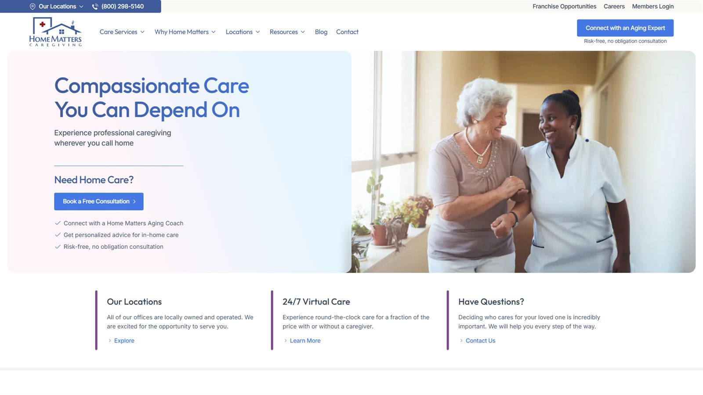</span>
                  <span class="device-label">Desktop · 1920px</span>
                </a>
              </li>
              <li>
                <a class="device device-laptop" href="images/home-matters-laptop.jpg" data-caption="Home Matters · Laptop · 1366px">
                  <span class="device-screen">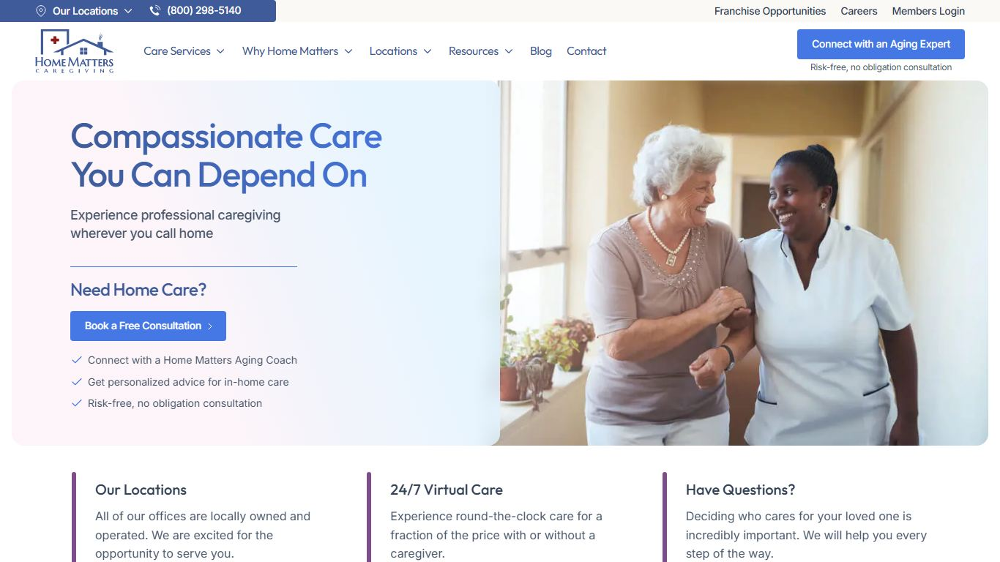</span>
                  <span class="device-label">Laptop · 1366px</span>
                </a>
              </li>
              <li>
                <a class="device device-tablet" href="images/home-matters-tablet.jpg" data-caption="Home Matters · Tablet · 768px">
                  <span class="device-screen">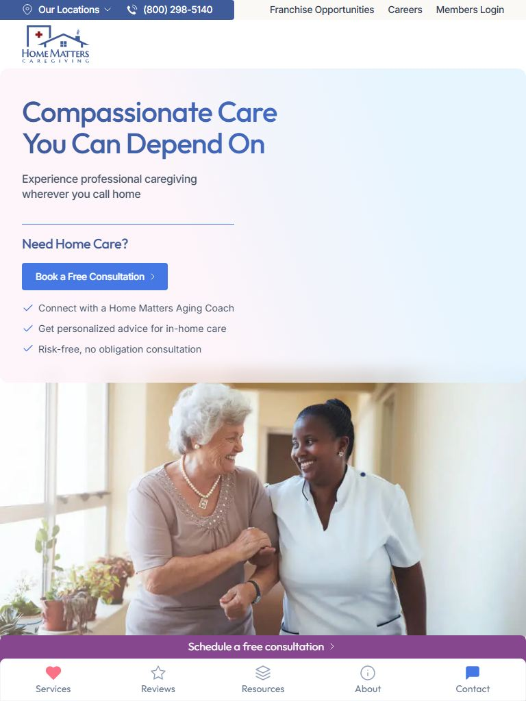</span>
                  <span class="device-label">Tablet · 768px</span>
                </a>
              </li>
              <li>
                <a class="device device-mobile" href="images/home-matters-mobile.jpg" data-caption="Home Matters · Mobile · 390px">
                  <span class="device-screen">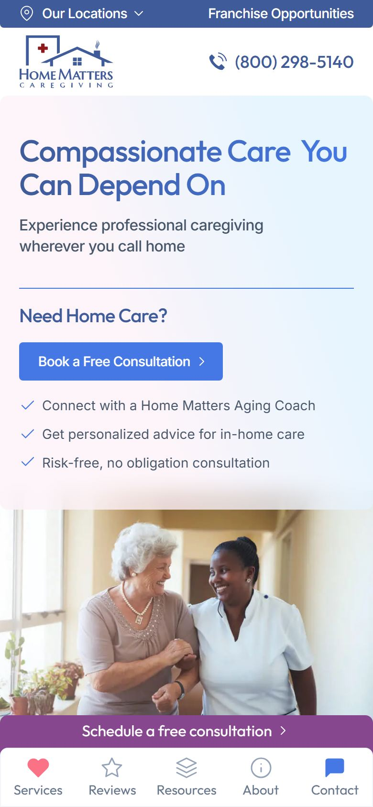</span>
                  <span class="device-label">Mobile · 390px</span>
                </a>
              </li>
            </ul>
            <div class="feat-body">
              <div class="feat-head">
                <h3>Home Matters</h3>
                <a class="btn feat-link" href="https://homematters.com/" target="_blank" rel="noopener noreferrer"
                  >View Live Website<span class="visually-hidden"> (opens in a new tab)</span></a
                >
              </div>
              <div class="feat-cols">
                <div class="feat-block">
                  <h4>Challenge</h4>
                  <p>
                    The website required many location-specific pages with
                    identical layouts but different content, creating
                    maintenance and scalability challenges.
                  </p>
                </div>
                <div class="feat-block">
                  <h4>My Contribution</h4>
                  <ul>
                    <li>Developed a custom ACF-powered location management system.</li>
                    <li>Eliminated the need for duplicate pages.</li>
                    <li>Built a reusable architecture for location-specific content.</li>
                    <li>Developed a custom mobile navigation system.</li>
                    <li>Worked on multiple frontend sections and page structures.</li>
                  </ul>
                </div>
                <div class="feat-block">
                  <h4>Impact</h4>
                  <ul>
                    <li>Simplified content management.</li>
                    <li>Improved scalability.</li>
                    <li>Reduced maintenance effort for future location expansion.</li>
                  </ul>
                </div>
              </div>
            </div>
          </article>

          <article class="feat-card reveal">
            <ul class="device-gallery" aria-label="New York Bagel Co. homepage at different screen sizes">
              <li>
                <a class="device device-desktop" href="images/new-york-bagel-desktop.jpg" data-caption="New York Bagel Co. · Desktop · 1920px">
                  <span class="device-screen">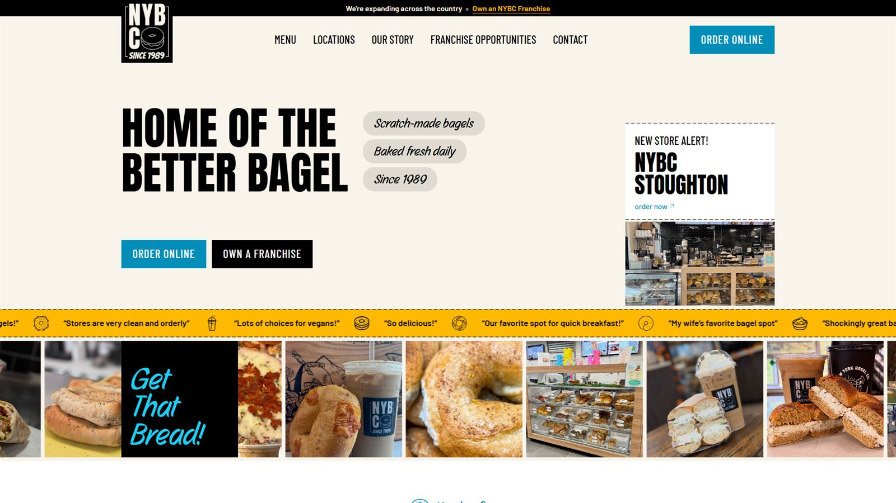</span>
                  <span class="device-label">Desktop · 1920px</span>
                </a>
              </li>
              <li>
                <a class="device device-laptop" href="images/new-york-bagel-laptop.jpg" data-caption="New York Bagel Co. · Laptop · 1366px">
                  <span class="device-screen">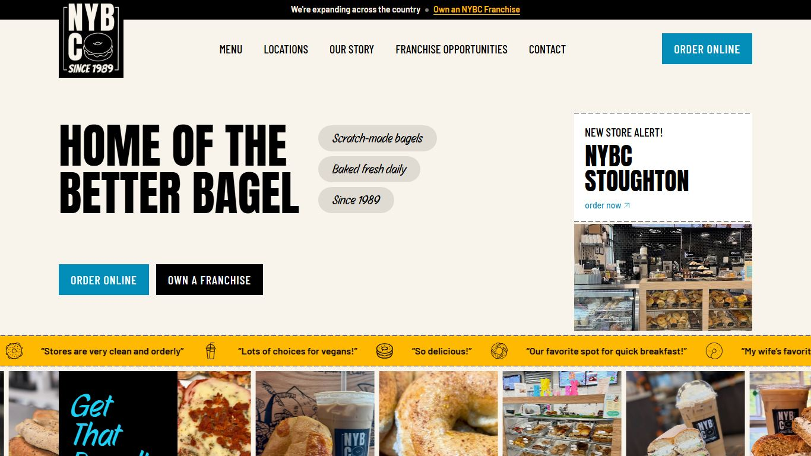</span>
                  <span class="device-label">Laptop · 1366px</span>
                </a>
              </li>
              <li>
                <a class="device device-tablet" href="images/new-york-bagel-tablet.jpg" data-caption="New York Bagel Co. · Tablet · 768px">
                  <span class="device-screen">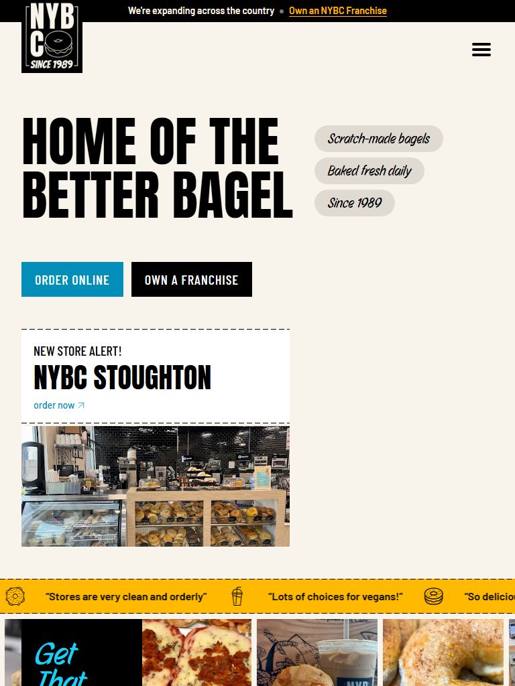</span>
                  <span class="device-label">Tablet · 768px</span>
                </a>
              </li>
              <li>
                <a class="device device-mobile" href="images/new-york-bagel-mobile.jpg" data-caption="New York Bagel Co. · Mobile · 390px">
                  <span class="device-screen">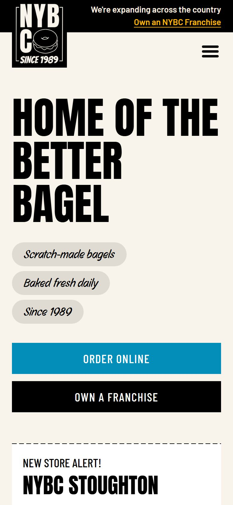</span>
                  <span class="device-label">Mobile · 390px</span>
                </a>
              </li>
            </ul>
            <div class="feat-body">
              <div class="feat-head">
                <h3>New York Bagel Co.</h3>
                <a class="btn feat-link" href="https://newyorkbagel.com/" target="_blank" rel="noopener noreferrer"
                  >View Live Website<span class="visually-hidden"> (opens in a new tab)</span></a
                >
              </div>
              <div class="feat-cols">
                <div class="feat-block">
                  <h4>Challenge</h4>
                  <p>
                    Managing menus and multiple business locations through
                    WordPress while maintaining a consistent user experience.
                  </p>
                </div>
                <div class="feat-block">
                  <h4>My Contribution</h4>
                  <ul>
                    <li>Built Home, About, Menu, Locations and Contact pages using Elementor.</li>
                    <li>Implemented full responsive support for desktop, tablet and mobile.</li>
                    <li>Created ACF-powered Custom Post Types for menu management.</li>
                    <li>Developed a dynamic location management system using custom post types.</li>
                  </ul>
                </div>
                <div class="feat-block">
                  <h4>Impact</h4>
                  <ul>
                    <li>Easier content updates from WordPress dashboard.</li>
                    <li>Scalable architecture for future menu items and locations.</li>
                    <li>Consistent experience across all devices.</li>
                  </ul>
                </div>
              </div>
            </div>
          </article>

          <article class="feat-card reveal">
            <ul class="device-gallery" aria-label="FranGrowth homepage at different screen sizes">
              <li>
                <a class="device device-desktop" href="images/frangrowth-desktop.jpg" data-caption="FranGrowth · Desktop · 1920px">
                  <span class="device-screen">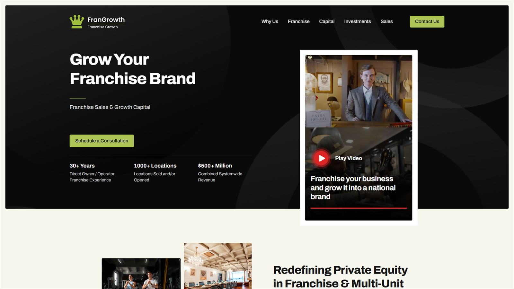</span>
                  <span class="device-label">Desktop · 1920px</span>
                </a>
              </li>
              <li>
                <a class="device device-laptop" href="images/frangrowth-laptop.jpg" data-caption="FranGrowth · Laptop · 1366px">
                  <span class="device-screen">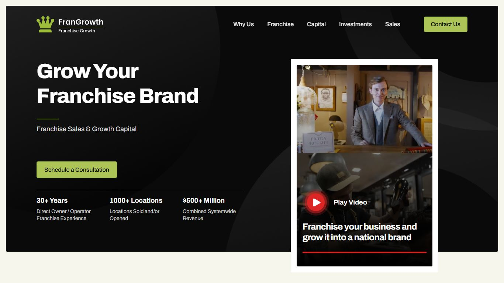</span>
                  <span class="device-label">Laptop · 1366px</span>
                </a>
              </li>
              <li>
                <a class="device device-tablet" href="images/frangrowth-tablet.jpg" data-caption="FranGrowth · Tablet · 768px">
                  <span class="device-screen">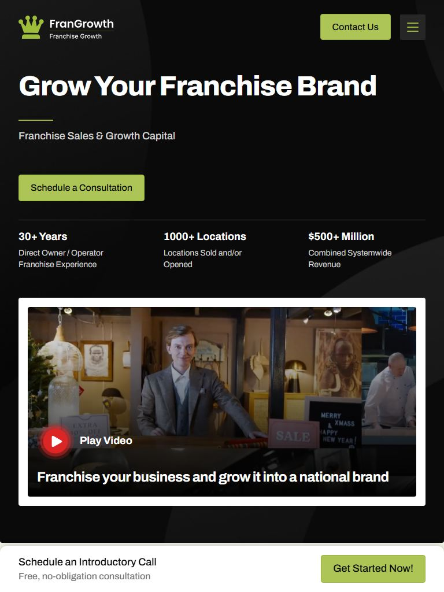</span>
                  <span class="device-label">Tablet · 768px</span>
                </a>
              </li>
              <li>
                <a class="device device-mobile" href="images/frangrowth-mobile.jpg" data-caption="FranGrowth · Mobile · 390px">
                  <span class="device-screen">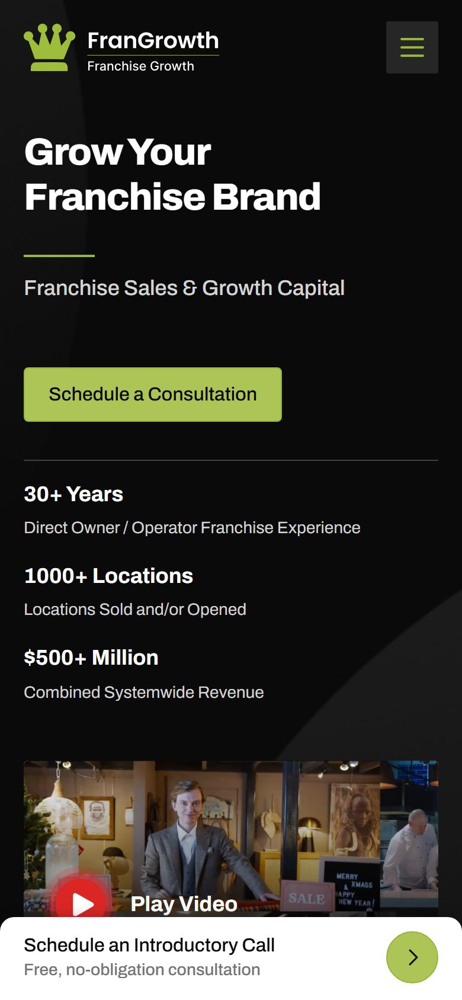</span>
                  <span class="device-label">Mobile · 390px</span>
                </a>
              </li>
            </ul>
            <div class="feat-body">
              <div class="feat-head">
                <h3>FranGrowth</h3>
                <a class="btn feat-link" href="https://frangrowth.com/" target="_blank" rel="noopener noreferrer"
                  >View Live Website<span class="visually-hidden"> (opens in a new tab)</span></a
                >
              </div>
              <div class="feat-cols">
                <div class="feat-block">
                  <h4>Challenge</h4>
                  <p>
                    Building responsive marketing pages and lead-generation
                    landing pages for franchise growth campaigns.
                  </p>
                </div>
                <div class="feat-block">
                  <h4>My Contribution</h4>
                  <ul>
                    <li>Developed responsive Elementor pages.</li>
                    <li>Created multiple landing pages.</li>
                    <li>Configured WS Form settings and lead capture forms.</li>
                    <li>Ensured mobile responsiveness across all pages.</li>
                  </ul>
                </div>
                <div class="feat-block">
                  <h4>Impact</h4>
                  <ul>
                    <li>Streamlined lead capture.</li>
                    <li>Improved marketing campaign deployment.</li>
                    <li>Consistent responsive user experience.</li>
                  </ul>
                </div>
              </div>
            </div>
          </article>
        </div>
      </section>

      <section id="experience">
        <div class="sec-head reveal">
          <div class="sec-eyebrow">Career</div>
          <h2 class="sec-title">Experience</h2>
        </div>
        <div class="timeline reveal">
          <div class="tl-item">
            <div class="tl-dot"></div>
            <div class="tl-card">
              <div class="tl-top">
                <span class="tl-role">WordPress Developer (WFH)</span
                ><span class="tl-date">March 2024 – Present</span>
              </div>
              <div class="tl-org">MadeByAura</div>
              <ul>
                <li>
                  Developed 10+ WordPress websites from Figma designs with
                  pixel-perfect accuracy and full responsiveness.
                </li>
                <li>
                  Maintaining 15+ live websites, handling updates, bug fixes,
                  and performance improvements.
                </li>
                <li>
                  Improved average website load speed by ~40% using optimization
                  best practices.
                </li>
                <li>
                  Built SEO-friendly page structures using proper HTML tags,
                  clean code, and fast-loading layouts.
                </li>
                <li>
                  Worked with Elementor Pro and ACF to create scalable,
                  client-friendly page management.
                </li>
                <li>
                  Maintained WooCommerce websites and used Git for version
                  control in a remote setup.
                </li>
              </ul>
            </div>
          </div>
          <div class="tl-item">
            <div class="tl-dot"></div>
            <div class="tl-card">
              <div class="tl-top">
                <span class="tl-role">Web Development Training</span
                ><span class="tl-date">Oct 2023 – Dec 2023</span>
              </div>
              <div class="tl-org">ConicPlex</div>
              <ul>
                <li>
                  Real-world development exposure working on live WordPress and
                  PHP-based projects.
                </li>
                <li>
                  Strengthened fundamentals of frontend-backend integration and
                  debugging.
                </li>
              </ul>
            </div>
          </div>
          <div class="tl-item">
            <div class="tl-dot"></div>
            <div class="tl-card">
              <div class="tl-top">
                <span class="tl-role">Web Developer Intern</span
                ><span class="tl-date">Dec 2022 – May 2023</span>
              </div>
              <div class="tl-org">HATKESH InfoTech Pvt. Ltd.</div>
              <ul>
                <li>
                  Sole web developer for a grocery store website project —
                  frontend and backend with PHP and MySQL.
                </li>
                <li>
                  Implemented dynamic features such as product catalog, cart
                  functionality, and user accounts.
                </li>
                <li>
                  Gained practical experience handling the complete project
                  lifecycle.
                </li>
              </ul>
            </div>
          </div>
        </div>
      </section>

      <section id="certifications">
        <div class="sec-head reveal">
          <div class="sec-eyebrow">Learning</div>
          <h2 class="sec-title">Certifications</h2>
        </div>
        <div class="cert-list reveal">
          <div class="cert-item">
            <span class="cname">UI/UX Basic — AT&amp;T E-Learning</span
            ><span class="cdate">Feb 2024</span>
          </div>
          <div class="cert-item">
            <span class="cname"
              >Build Responsive Real World Portfolio WordPress Website —
              Udemy</span
            ><span class="cdate">Jan 2024</span>
          </div>
          <div class="cert-item">
            <span class="cname"
              >Web Development Wizardry: HTML &amp; CSS for Beginners —
              Udemy</span
            ><span class="cdate">Jan 2024</span>
          </div>
          <div class="cert-item">
            <span class="cname">Learn Bootstrap – For Beginners — Udemy</span
            ><span class="cdate">Jan 2024</span>
          </div>
          <div class="cert-item">
            <span class="cname">Git for Beginners — Udemy</span
            ><span class="cdate">Jan 2024</span>
          </div>
          <div class="cert-item">
            <span class="cname"
              >WordPress Crash Course: Build any Website in Minutes —
              Udemy</span
            ><span class="cdate">Sep 2023</span>
          </div>
        </div>
      </section>

      <section id="education">
        <div class="sec-head reveal">
          <div class="sec-eyebrow">Background</div>
          <h2 class="sec-title">Education &amp; Languages</h2>
        </div>
        <div class="edu-lang reveal">
          <div class="edu-card">
            <h3>B.Tech in Computer Engineering</h3>
            <div class="school">BVM Engineering College, Gujarat</div>
            <div class="yr">Completed 2025</div>
          </div>
          <div class="lang-card">
            <h3>Languages</h3>
            <div class="lang-row"><span>English</span></div>
            <div class="lang-row"><span>Hindi</span></div>
            <div class="lang-row"><span>Gujarati</span></div>
          </div>
        </div>
      </section>

      <section id="contact">
        <div class="contact-card reveal">
          <h2>Need Help With Your WordPress Website?</h2>
          <p>
            Whether you need a landing page, Elementor development, WooCommerce
            setup, ACF implementation or website improvements, let's discuss
            your project.
          </p>
          <div class="contact-links">
            <a class="btn primary" href="mailto:pathanashrafi2709@gmail.com"
              >Email Me</a
            >
            <a
              class="btn"
              href="https://www.linkedin.com/in/ashrafi-khan-pathan-2824891b2"
              target="_blank"
              rel="noopener noreferrer"
              >View LinkedIn</a
            >
            <a class="btn" href="Ashrafi_Pathan_Resume.pdf" download>Download Resume</a>
          </div>
        </div>
      </section>
    </main>

    <footer>
      Designed &amp; built by Ashrafi Khan Pathan · Gujarat, India
    </footer>

    <dialog class="lightbox" id="lightbox" aria-label="Screenshot viewer">
      <figure class="lb-figure">
        
        <figcaption></figcaption>
      </figure>
      <button type="button" class="lb-btn lb-close" aria-label="Close">&times;</button>
      <button type="button" class="lb-btn lb-prev" aria-label="Previous screenshot">&#8249;</button>
      <button type="button" class="lb-btn lb-next" aria-label="Next screenshot">&#8250;</button>
    </dialog>

    <script src="script.js"></script>
  </body>
</html>
```

## `style.css`

```css
/* ---------- Dark theme (default) — "Graphite night" ----------
     Charcoal drafting desk, a quiet blue construction grid, hairline cards with a
     blue offset shadow. Shares its structure with the light "Blueprint paper" theme. */
  :root{
    --ink-rgb: 236,238,242;
    --bp-rgb: 107,140,255;
    --bg: #111316;
    --bg-2: #16181c;
    --paper: #181a1f;
    --panel: var(--paper);
    --panel-border: rgba(236,238,242,0.10);
    --panel-border-hi: rgba(236,238,242,0.45);
    --line-strong: rgba(236,238,242,0.32);
    --btn-border: rgba(236,238,242,0.22);
    --text: #eceef2;
    --text-dim: #b3b7c0;
    --text-faint: #8b909a;
    --accent: #8aa4ff;
    --accent-2: #a3b1d9;
    --accent-fill: #4766e8;
    --on-accent: #ffffff;
    --accent-glow: rgba(107,140,255,0.22);
    --nav-bg: rgba(17,19,22,0.86);
    --nav-bg-mobile: rgba(17,19,22,0.97);
    --card-shadow: 3px 3px 0 rgba(107,140,255,0.14);
    --card-shadow-hover: 6px 6px 0 rgba(107,140,255,0.30);
    --sheet-shadow: 10px 10px 0 rgba(107,140,255,0.18);
    --selection: rgba(107,140,255,0.35);
    --grid-major: 0.07;
    --grid-minor: 0.03;
    --noise-opacity: 0.03;
    --noise-blend: overlay;
    --dot-3: #4a4e57;
    --radius: 10px;
    --ff-display: 'Space Grotesk', sans-serif;
    --ff-body: 'Inter', sans-serif;
    --ff-mono: 'JetBrains Mono', monospace;
  }

  /* ---------- Light theme — "Blueprint paper" ----------
     Warm drafting paper, a blue construction grid, ink hairlines and a blue
     offset shadow on cards (like slightly misregistered print). */
  html.light-mode{
    --ink-rgb: 20,22,26;
    --bp-rgb: 31,79,216;
    --bg: #f4f1ea;
    --bg-2: #ece7dc;
    --paper: #fffdf8;
    --panel-border: rgba(20,22,26,0.18);
    --panel-border-hi: #14161a;
    --line-strong: #14161a;
    --btn-border: rgba(20,22,26,0.35);
    --text: #14161a;
    --text-dim: #43464e;
    --text-faint: #62656d;
    --accent: #1f4fd8;
    --accent-2: #3a5597;
    --accent-fill: #1f4fd8;
    --on-accent: #ffffff;
    --accent-glow: rgba(31,79,216,0.18);
    --nav-bg: rgba(244,241,234,0.86);
    --nav-bg-mobile: rgba(244,241,234,0.97);
    --card-shadow: 3px 3px 0 rgba(31,79,216,0.12);
    --card-shadow-hover: 6px 6px 0 rgba(31,79,216,0.24);
    --sheet-shadow: 10px 10px 0 rgba(31,79,216,0.16);
    --selection: rgba(31,79,216,0.2);
    --grid-major: 0.13;
    --grid-minor: 0.055;
    --noise-opacity: 0.05;
    --noise-blend: multiply;
    --dot-3: #b9bcc4;
  }

  /* ---------- Shared blueprint system (both themes) ----------
     Rules are prefixed with `html` so they win over the component defaults below. */
  html ::selection{ background: var(--selection); color: var(--text); }

  /* Solid cards — no frosted-glass blur */
  html .skill-card, html .svc-card, html .feat-card, html .tl-card, html .stat-card,
  html .cert-item, html .edu-card, html .lang-card, html .proof-card, html .float-chip, html nav{
    backdrop-filter: none; -webkit-backdrop-filter: none;
  }
  .skill-card, .svc-card, .feat-card, .tl-card, .stat-card, .cert-item, .edu-card, .lang-card, .proof-card{
    position: relative;
  }

  /* Buttons: card-colored with a hairline; primary is blueprint blue with a hard shadow */
  html .btn{ background: var(--paper); border-color: var(--btn-border); backdrop-filter: none; border-radius: 6px; }
  html .btn:not(.primary):hover{
    background: var(--paper); border-color: var(--text); box-shadow: 3px 3px 0 rgba(var(--bp-rgb),0.3);
  }
  html .btn.primary{
    background: var(--accent-fill); border-color: var(--text); color: var(--on-accent);
    box-shadow: 3px 3px 0 var(--text);
  }
  html .btn.primary:hover{ transform: translate(-2px,-2px); box-shadow: 5px 5px 0 var(--text); }

  html .chip{ background: rgba(var(--bp-rgb),0.07); border-color: rgba(var(--bp-rgb),0.24); }
  html .chip:hover{ background: rgba(var(--bp-rgb),0.13); border-color: rgba(var(--bp-rgb),0.48); }

  /* Hero code card drawn as a technical sheet */
  html .glass-card{
    background: var(--paper); border-color: var(--line-strong);
    backdrop-filter: none; -webkit-backdrop-filter: none;
    box-shadow: var(--sheet-shadow);
  }
  html .glass-card .bar{ background: rgba(var(--bp-rgb),0.05); border-bottom-color: var(--panel-border); }
  html .glass-card .dot:nth-child(1){ background: var(--text); }
  html .glass-card .dot:nth-child(2){ background: var(--accent); }
  html .glass-card .dot:nth-child(3){ background: var(--dot-3); }
  html .float-chip{
    background: var(--paper); border-color: var(--line-strong); box-shadow: 3px 3px 0 rgba(var(--bp-rgb),0.25);
  }
  html .contact-card{
    background: var(--paper); border-color: var(--line-strong); border-radius: 12px;
    backdrop-filter: none; -webkit-backdrop-filter: none;
    box-shadow: var(--sheet-shadow);
  }

  /* Drafting-style annotations */
  .sec-eyebrow::before{ content: '// '; opacity: 0.7; }
  html .kame-wave{
    background: linear-gradient(180deg, transparent, rgba(var(--bp-rgb),0.9), rgba(var(--bp-rgb),0.4), transparent);
    box-shadow: 0 0 24px 6px rgba(var(--bp-rgb),0.35);
  }

  *{ box-sizing: border-box; margin:0; padding:0; }

  html{ scroll-behavior: smooth; }

  body{
    background: var(--bg);
    color: var(--text);
    font-family: var(--ff-body);
    line-height: 1.6;
    overflow-x: hidden;
    min-height: 100vh;
  }

  a{ color: inherit; text-decoration: none; }

  /* Classes like .btn set display, which would otherwise override the hidden attribute */
  [hidden]{ display: none !important; }
  .nowrap{ white-space: nowrap; }
  .visually-hidden{
    position: absolute !important; width: 1px; height: 1px; padding: 0; margin: -1px;
    overflow: hidden; clip: rect(0 0 0 0); white-space: nowrap; border: 0;
  }

  .noise{
    position: fixed; inset:0; pointer-events:none; z-index: 1; opacity: var(--noise-opacity); mix-blend-mode: var(--noise-blend);
    background-image: url("data:image/svg+xml,%3Csvg xmlns='http://www.w3.org/2000/svg' width='120' height='120'%3E%3Cfilter id='n'%3E%3CfeTurbulence type='fractalNoise' baseFrequency='0.9' numOctaves='2' stitchTiles='stitch'/%3E%3C/filter%3E%3Crect width='100%25' height='100%25' filter='url(%23n)'/%3E%3C/svg%3E");
  }

  /* Full-page construction grid: minor 24px lines, major 120px lines */
  .grid-glow{
    position: fixed; inset: 0; z-index: 0; pointer-events: none;
    background-image:
      linear-gradient(rgba(var(--bp-rgb),var(--grid-major)) 1px, transparent 1px),
      linear-gradient(90deg, rgba(var(--bp-rgb),var(--grid-major)) 1px, transparent 1px),
      linear-gradient(rgba(var(--bp-rgb),var(--grid-minor)) 1px, transparent 1px),
      linear-gradient(90deg, rgba(var(--bp-rgb),var(--grid-minor)) 1px, transparent 1px);
    background-size: 120px 120px, 120px 120px, 24px 24px, 24px 24px;
  }

  .wrap{ max-width: 1120px; margin: 0 auto; padding: 0 clamp(24px, 5vw, 64px); position: relative; z-index: 2; }

  /* ---------- NAV ---------- */
  nav{
    position: fixed; top: 0; left: 0; right: 0; z-index: 50;
    backdrop-filter: blur(16px) saturate(140%);
    -webkit-backdrop-filter: blur(16px) saturate(140%);
    background: var(--nav-bg);
    border-bottom: 1px solid var(--panel-border);
  }
  nav .wrap{ display:flex; align-items:center; justify-content:space-between; height: 64px; }
  .logo{ font-family: var(--ff-display); font-weight:700; font-size: 1.05rem; letter-spacing: 0.02em; }
  .logo span{ color: var(--accent); }
  .navlinks{ display:flex; gap: 28px; font-family: var(--ff-mono); font-size: 0.8rem; color: var(--text-dim); }
  .navlinks a{ transition: color .25s ease; position: relative; }
  .navlinks a:hover{ color: var(--text); }
  .navlinks a::after{
    content:''; position:absolute; left:0; bottom:-6px; width:0; height:1px; background: var(--accent);
    transition: width .25s ease;
  }
  .navlinks a:hover::after{ width: 100%; }

  .nav-actions{ display:flex; align-items:center; gap: 14px; }

  .theme-toggle{
    width: 44px; height: 24px; border-radius: 999px; flex-shrink: 0;
    border: 1px solid var(--panel-border); background: var(--panel);
    position: relative; cursor: pointer; padding: 0; transition: border-color .3s ease, background .3s ease;
  }
  .theme-toggle:hover{ border-color: var(--panel-border-hi); }
  .theme-toggle .knob{
    position: absolute; top: 2px; left: 2px; width: 18px; height: 18px; border-radius: 50%;
    background: var(--text); box-shadow: 0 0 8px rgba(var(--ink-rgb),0.4);
    transition: transform .35s cubic-bezier(.34,1.56,.64,1);
  }
  html.light-mode .theme-toggle .knob{ transform: translateX(20px); }

  .nav-toggle{
    display:none; width: 36px; height: 36px; border-radius: 9px; border: 1px solid var(--panel-border);
    background: var(--panel); align-items:center; justify-content:center; flex-direction: column; gap: 4px; cursor:pointer;
  }
  .nav-toggle span{ width: 16px; height: 1.5px; background: var(--text); transition: transform .25s ease, opacity .25s ease; }
  .nav-toggle.open span:nth-child(1){ transform: translateY(5.5px) rotate(45deg); }
  .nav-toggle.open span:nth-child(2){ opacity: 0; }
  .nav-toggle.open span:nth-child(3){ transform: translateY(-5.5px) rotate(-45deg); }

  @media (max-width: 720px){
    .navlinks{
      position: absolute; top: 64px; left: 0; right: 0; flex-direction: column; gap: 0;
      background: var(--nav-bg-mobile); backdrop-filter: blur(16px);
      border-bottom: 1px solid var(--panel-border);
      max-height: 0; overflow: hidden;
      /* visibility keeps the collapsed links out of the Tab order */
      visibility: hidden; transition: max-height .3s ease, visibility 0s linear .3s;
    }
    .navlinks.open{ max-height: 400px; visibility: visible; transition: max-height .3s ease, visibility 0s; }
    .navlinks a{ padding: 16px 28px; border-bottom: 1px solid var(--panel-border); }
    .nav-toggle{ display:flex; }
  }

  /* ---------- HERO ---------- */
  header.hero{
    display:flex; align-items:center; position: relative;
    padding-top: 150px; padding-bottom: 90px;
  }
  .hero-inner{ display:grid; grid-template-columns: 1.1fr 0.9fr; gap: 48px; align-items:center; }
  .hero-inner > *{ min-width: 0; }
  @media (max-width: 860px){ .hero-inner{ grid-template-columns: 1fr; } }

  .eyebrow{
    font-family: var(--ff-mono); font-size: 0.78rem; color: var(--accent-2);
    letter-spacing: 0.12em; text-transform: uppercase; display:flex; align-items:center; gap:10px; margin-bottom: 20px;
  }
  .eyebrow::before{ content:''; width: 26px; height:1px; background: var(--accent-2); display:inline-block; }

  h1.name{
    font-family: var(--ff-display); font-weight: 700; font-size: clamp(2.4rem, 5.2vw, 3.6rem);
    line-height: 1.05; letter-spacing: -0.01em; margin-bottom: 18px;
  }
  .hero-tagline{
    font-family: var(--ff-display); font-weight: 600; font-size: clamp(1.15rem, 2vw, 1.45rem);
    line-height: 1.3; color: var(--text); max-width: 30ch; margin-bottom: 16px; text-wrap: balance;
  }
  h1.name .grad{ color: var(--accent); }

  .summary{ color: var(--text-dim); max-width: 56ch; font-size: 1rem; margin-bottom: 30px; }

  .cta-row{ display:flex; gap: 14px; flex-wrap: wrap; }

  .trust-line{
    list-style: none; display:flex; flex-wrap: wrap; gap: 8px 20px; margin-top: 26px;
    font-family: var(--ff-mono); font-size: 0.76rem; color: var(--text-dim);
  }
  .trust-line li{ display:flex; align-items:center; gap: 7px; }
  .trust-line li::before{ content: '✔'; color: var(--accent); font-size: 0.8em; }
  .btn{
    font-family: var(--ff-mono); font-size: 0.82rem; padding: 12px 22px; border-radius: 999px;
    border: 1px solid var(--panel-border); background: var(--panel); backdrop-filter: blur(10px);
    transition: all .3s ease; cursor: pointer; display:inline-flex; align-items:center; gap:8px;
  }
  .btn.primary{
    background: linear-gradient(135deg, #ffffff, #b4b4bc);
    border-color: transparent; color: #0a0a0b; font-weight: 600; box-shadow: 0 8px 30px -8px var(--accent-glow);
  }
  .btn.primary:hover{ transform: translateY(-2px); box-shadow: 0 12px 34px -8px var(--accent-glow); }
  .btn:not(.primary):hover{ border-color: var(--panel-border-hi); background: rgba(var(--ink-rgb),0.08); transform: translateY(-2px); }

  /* Signature 3D glass window */
  .stage{ position: relative; perspective: 1200px; width: 100%; max-width: 460px; margin: 0 auto; }
  .glass-card{
    position: relative; border-radius: var(--radius); width: 100%;
    background: linear-gradient(160deg, rgba(var(--ink-rgb),0.09), rgba(var(--ink-rgb),0.02));
    border: 1px solid var(--panel-border-hi);
    backdrop-filter: blur(18px) saturate(160%); -webkit-backdrop-filter: blur(18px) saturate(160%);
    box-shadow: var(--card-shadow), 0 30px 70px -25px rgba(0,0,0,0.6), 0 40px 100px -30px var(--accent-glow);
    transform-style: preserve-3d; transform: rotateX(8deg) rotateY(-14deg);
    transition: transform .15s ease-out;
    padding: 0;
  }
  .glass-inner{ border-radius: var(--radius); overflow: hidden; }
  .glass-card .bar{
    display:flex; align-items:center; gap: 7px; padding: 13px 16px; border-bottom: 1px solid var(--panel-border);
    background: rgba(var(--ink-rgb),0.03);
  }
  .glass-card .dot{ width:10px; height:10px; border-radius:50%; flex-shrink: 0; }
  .glass-card .dot:nth-child(1){ background:#e4e4e8; }
  .glass-card .dot:nth-child(2){ background:#9a9aa2; }
  .glass-card .dot:nth-child(3){ background:#5c5c64; }
  .glass-card .url{ margin-left: 10px; font-family: var(--ff-mono); font-size: 0.68rem; color: var(--text-faint); }
  .glass-card .code{ padding: 22px 22px 26px; font-family: var(--ff-mono); font-size: 0.82rem; color: var(--text-dim); overflow-x: auto; max-width: 100%; scrollbar-width: none; -ms-overflow-style: none; }
  .glass-card .code::-webkit-scrollbar{ width: 0; height: 0; }
  .glass-card .code .ln{ color: var(--text-faint); display:inline-block; width: 22px; user-select:none; }
  .glass-card .code .kw{ color: var(--accent); }
  .glass-card .code .str{ color: var(--accent-2); }
  .glass-card .code .fn{ color: var(--accent-2); }
  .glass-card .code .cmt{ color: var(--text-faint); }
  .glass-card .code div{ white-space: pre; }
  @media (max-width: 480px){ .glass-card .code{ font-size: 0.72rem; } }

  .float-chip{
    position:absolute; font-family: var(--ff-mono); font-size: 0.72rem; padding: 8px 14px; border-radius: 12px;
    background: var(--panel); border: 1px solid var(--panel-border); backdrop-filter: blur(12px);
    box-shadow: 0 14px 30px -10px rgba(0,0,0,0.5); transform: translateZ(40px);
  }
  .float-chip.c1{ top: -18px; right: -14px; color: var(--accent-2); }
  .float-chip.c2{ bottom: -16px; left: -18px; color: var(--accent); }

  @media (max-width: 860px){ .glass-card{ transform: none; } .stage{ perspective:none; } }
  @media (max-width: 520px){
    .float-chip{ font-size: 0.62rem; padding: 6px 10px; }
    .float-chip.c1{ top: -12px; right: 4px; }
    .float-chip.c2{ bottom: -12px; left: 4px; }
  }

  /* ---------- SECTIONS ---------- */
  section{ padding: 110px 0; position: relative; }
  .sec-head{ margin-bottom: 48px; }
  .sec-eyebrow{ font-family: var(--ff-mono); font-size: 0.75rem; color: var(--accent-2); letter-spacing: 0.1em; text-transform: uppercase; margin-bottom: 10px; }
  .sec-title{ font-family: var(--ff-display); font-size: clamp(1.7rem, 3.2vw, 2.3rem); font-weight: 700; }

  /* Reveal styles only apply when JS is running (html.js), so content stays visible without it */
  .js .reveal{ opacity: 0; transform: translateY(28px); transition: opacity .7s ease, transform .7s ease; }
  .js .reveal.in{ opacity: 1; transform: translateY(0); }

  /* Staggered children for grid sections — parent fades in place, children cascade individually */
  .js .skill-groups.reveal, .js .svc-grid.reveal, .js .proof-banner.reveal, .js .cert-list.reveal, .js .timeline.reveal{
    opacity: 1; transform: none; transition: none;
  }
  .js .skill-groups > *, .js .svc-grid > *, .js .proof-banner > *, .js .cert-list > *, .js .timeline > .tl-item{
    opacity: 0; transform: translateY(26px);
    transition: opacity .6s ease, transform .6s ease;
  }
  .js .skill-groups.in > *, .js .svc-grid.in > *, .js .proof-banner.in > *, .js .cert-list.in > *, .js .timeline.in > .tl-item{
    opacity: 1; transform: translateY(0);
  }
  .skill-groups > *:nth-child(1), .svc-grid > *:nth-child(1), .proof-banner > *:nth-child(1), .cert-list > *:nth-child(1), .timeline > .tl-item:nth-child(1){ transition-delay: .05s; }
  .skill-groups > *:nth-child(2), .svc-grid > *:nth-child(2), .proof-banner > *:nth-child(2), .cert-list > *:nth-child(2), .timeline > .tl-item:nth-child(2){ transition-delay: .15s; }
  .skill-groups > *:nth-child(3), .svc-grid > *:nth-child(3), .proof-banner > *:nth-child(3), .cert-list > *:nth-child(3), .timeline > .tl-item:nth-child(3){ transition-delay: .25s; }
  .skill-groups > *:nth-child(4), .proof-banner > *:nth-child(4), .cert-list > *:nth-child(4){ transition-delay: .35s; }
  .skill-groups > *:nth-child(5), .proof-banner > *:nth-child(5), .cert-list > *:nth-child(5){ transition-delay: .45s; }
  .skill-groups > *:nth-child(6), .cert-list > *:nth-child(6){ transition-delay: .55s; }

  /* About */
  .about-grid{ display:grid; grid-template-columns: 1.3fr 0.7fr; gap: 40px; }
  .about-grid > *{ min-width: 0; }
  @media (max-width: 780px){ .about-grid{ grid-template-columns: 1fr; } }
  .about-text{ color: var(--text-dim); font-size: 1rem; }
  .about-text p + p{ margin-top: 16px; }
  .stat-card{
    background: var(--panel); border:1px solid var(--panel-border); border-radius: var(--radius);
    padding: 22px; backdrop-filter: blur(14px); text-align:center;
    box-shadow: var(--card-shadow); transition: transform .35s ease, box-shadow .35s ease, border-color .35s ease;
  }
  .stat-card:hover{ transform: translateY(-5px); box-shadow: var(--card-shadow-hover); border-color: var(--panel-border-hi); }
  .stat-grid{ display:grid; grid-template-columns: 1fr 1fr; gap: 14px; perspective: 800px; }
  .stat-num{ font-family: var(--ff-display); font-size: 1.9rem; font-weight:700; color: var(--accent); }
  .stat-label{ font-family: var(--ff-mono); font-size: 0.68rem; color: var(--text-faint); margin-top: 4px; letter-spacing: 0.04em; }

  /* Skills */
  .skill-groups{ display:grid; grid-template-columns: repeat(3, 1fr); gap: 18px; perspective: 800px; }
  .skill-groups > *{ min-width: 0; }
  @media (max-width: 780px){ .skill-groups{ grid-template-columns: 1fr 1fr; } }
  @media (max-width: 480px){ .skill-groups{ grid-template-columns: 1fr; } }
  .skill-card{
    background: var(--panel); border:1px solid var(--panel-border); border-radius: var(--radius);
    padding: 22px; backdrop-filter: blur(14px); transition: transform .35s ease, border-color .35s ease, box-shadow .35s ease;
    box-shadow: var(--card-shadow);
  }
  .skill-card:hover{ transform: translateY(-5px); border-color: var(--panel-border-hi); box-shadow: var(--card-shadow-hover); }
  .skill-card h3{ font-family: var(--ff-mono); font-size: 0.72rem; color: var(--accent-2); text-transform: uppercase; letter-spacing: 0.08em; margin-bottom: 14px; }
  .chip-row{ display:flex; flex-wrap: wrap; gap: 8px; }
  .chip{
    font-family: var(--ff-mono); font-size: 0.75rem; padding: 6px 12px; border-radius: 8px;
    background: rgba(var(--ink-rgb),0.06); border: 1px solid rgba(var(--ink-rgb),0.14); color: var(--text);
    transition: transform .25s ease, background .25s ease, border-color .25s ease;
  }
  .chip:hover{ transform: translateY(-2px) scale(1.04); background: rgba(var(--ink-rgb),0.12); border-color: rgba(var(--ink-rgb),0.3); }

  /* Experience timeline */
  .timeline{ position: relative; padding-left: 32px; perspective: 800px; }
  .timeline::before{ content:''; position:absolute; left: 6px; top: 6px; bottom: 6px; width: 1px; background: linear-gradient(var(--accent), transparent); }
  .tl-item{ position: relative; margin-bottom: 40px; }
  .tl-item:last-child{ margin-bottom: 0; }
  .tl-dot{ position:absolute; left: -32px; top: 6px; width: 13px; height: 13px; border-radius:50%; background: var(--bg); border: 2px solid var(--accent); box-shadow: 0 0 0 4px rgba(var(--bp-rgb),0.14); }
  .tl-card{
    background: var(--panel); border: 1px solid var(--panel-border); border-radius: var(--radius);
    padding: 24px 26px; backdrop-filter: blur(14px);
    box-shadow: var(--card-shadow); transition: transform .35s ease, box-shadow .35s ease, border-color .35s ease;
  }
  .tl-card:hover{ transform: translateY(-4px); box-shadow: var(--card-shadow-hover); border-color: var(--panel-border-hi); }
  .tl-top{ display:flex; justify-content: space-between; align-items: baseline; flex-wrap: wrap; gap: 8px; margin-bottom: 6px; }
  .tl-role{ font-family: var(--ff-display); font-weight: 600; font-size: 1.08rem; }
  .tl-date{ font-family: var(--ff-mono); font-size: 0.72rem; color: var(--accent-2); }
  .tl-org{ color: var(--text-dim); font-size: 0.88rem; margin-bottom: 14px; }
  .tl-card ul{ padding-left: 18px; color: var(--text-dim); font-size: 0.92rem; }
  .tl-card li{ margin-bottom: 7px; }
  .tl-card li::marker{ color: var(--accent); }

  /* Social proof banner */
  .proof-banner{
    list-style: none; display:grid; grid-template-columns: repeat(5, 1fr); gap: 14px;
    padding-top: 10px; perspective: 800px;
  }
  .proof-banner > *{ min-width: 0; }
  @media (max-width: 960px){ .proof-banner{ grid-template-columns: repeat(3, 1fr); } }
  @media (max-width: 560px){ .proof-banner{ grid-template-columns: 1fr 1fr; } .proof-card:last-child{ grid-column: 1 / -1; } }
  .proof-card{
    display:flex; flex-direction: column; justify-content: center; gap: 4px; text-align: center;
    background: var(--panel); border: 1px solid var(--panel-border); border-radius: var(--radius);
    padding: 20px 14px; backdrop-filter: blur(14px);
    box-shadow: var(--card-shadow); transition: transform .35s ease, box-shadow .35s ease, border-color .35s ease;
  }
  .proof-card:hover{ transform: translateY(-4px); box-shadow: var(--card-shadow-hover); border-color: var(--panel-border-hi); }
  .proof-num{ font-family: var(--ff-display); font-weight: 700; font-size: 1.35rem; color: var(--accent); line-height: 1.2; }
  .proof-label{ font-family: var(--ff-mono); font-size: 0.68rem; color: var(--text-faint); letter-spacing: 0.04em; }

  /* Services */
  .svc-grid{ display:grid; grid-template-columns: repeat(3, 1fr); gap: 18px; perspective: 800px; }
  .svc-grid > *{ min-width: 0; }
  @media (max-width: 860px){ .svc-grid{ grid-template-columns: 1fr; } }
  .svc-card{
    background: var(--panel); border: 1px solid var(--panel-border); border-radius: var(--radius);
    padding: 28px 26px; backdrop-filter: blur(14px);
    box-shadow: var(--card-shadow); transition: transform .35s ease, box-shadow .35s ease, border-color .35s ease;
  }
  .svc-card:hover{ transform: translateY(-5px); box-shadow: var(--card-shadow-hover); border-color: var(--panel-border-hi); }
  .svc-num{ display:block; font-family: var(--ff-mono); font-size: 0.75rem; color: var(--text-faint); margin-bottom: 18px; }
  .svc-card h3{ font-family: var(--ff-display); font-size: 1.15rem; margin-bottom: 10px; }
  .svc-card p{ color: var(--text-dim); font-size: 0.92rem; }

  /* Featured projects — large case-study cards */
  .feat-list{ display:grid; gap: 28px; }
  .feat-card{
    background: var(--panel); border: 1px solid var(--panel-border); border-radius: var(--radius);
    backdrop-filter: blur(14px); overflow: hidden;
    box-shadow: var(--card-shadow); transition: box-shadow .35s ease, border-color .35s ease;
  }
  .feat-card:hover{ box-shadow: var(--card-shadow-hover); border-color: var(--panel-border-hi); }
  /* Responsive device lineup — desktop, laptop, tablet, phone side by side, bottom-aligned.
     Column ratios give the four frames roughly matching heights. */
  .device-gallery{
    list-style: none; display:grid; grid-template-columns: 4.5fr 3.6fr 1.7fr 1fr; align-items: end; gap: 18px;
    padding: 32px 32px 26px; border-bottom: 1px solid var(--panel-border);
    background: radial-gradient(ellipse 80% 90% at 50% 100%, rgba(var(--ink-rgb),0.06), transparent 70%);
  }
  .device-gallery > li{ min-width: 0; }
  .device{
    display:block; text-align:center; cursor: zoom-in; border-radius: 12px;
    transition: transform .3s ease;
  }
  .device:hover{ transform: translateY(-4px); }
  .device-screen{
    display:block; position: relative; background: #1b1b1f; padding: 5px;
    border-radius: 10px; box-shadow: 0 0 0 1px rgba(var(--ink-rgb),0.16), 0 14px 30px -12px rgba(0,0,0,0.6);
  }
  .device-screen img{ display:block; width: 100%; height: auto; border-radius: 5px; background: var(--bg-2); }
  .device-laptop .device-screen{ border-radius: 10px 10px 4px 4px; }
  /* Laptop base */
  .device-laptop .device-screen::after{
    content:''; position:absolute; left: -7%; right: -7%; bottom: -7px; height: 7px;
    background: #2a2a2f; border-radius: 0 0 8px 8px; box-shadow: 0 0 0 1px rgba(var(--ink-rgb),0.12);
  }
  .device-tablet .device-screen{ padding: 6px; border-radius: 14px; }
  .device-tablet .device-screen img{ border-radius: 8px; }
  .device-mobile .device-screen{ padding: 4px; border-radius: 16px; }
  .device-mobile .device-screen img{ border-radius: 12px; }
  .device-label{
    display:block; margin-top: 14px; font-family: var(--ff-mono); font-size: 0.66rem;
    color: var(--text-faint); letter-spacing: 0.04em; white-space: nowrap;
  }
  .device:hover .device-label{ color: var(--text); }

  /* Device switcher — tab bar built by script.js; only shown on small screens */
  .device-switch{ display:none; }

  @media (max-width: 720px){
    /* Without JS: a simple 2x2 grid, no horizontal scrolling */
    .device-gallery{ grid-template-columns: 1fr 1fr; gap: 18px 14px; padding: 24px 20px 20px; }

    /* With JS: one device at a time, switched from the tab bar or by swiping */
    .js .device-showcase{
      padding: 20px 20px 22px; border-bottom: 1px solid var(--panel-border);
      background: radial-gradient(ellipse 80% 70% at 50% 100%, rgba(var(--ink-rgb),0.07), transparent 70%);
    }
    .js .device-switch{
      display:flex; gap: 4px; padding: 4px; margin-bottom: 22px;
      border: 1px solid var(--panel-border); border-radius: 14px; background: rgba(var(--ink-rgb),0.04);
    }
    .device-switch button{
      flex: 1; min-width: 0; display:flex; flex-direction: column; align-items:center; gap: 4px;
      padding: 8px 2px 7px; border: 0; border-radius: 10px; background: none; cursor: pointer;
      color: var(--text-faint); font-family: var(--ff-mono); font-size: 0.62rem; letter-spacing: 0.03em;
      transition: background .25s ease, color .25s ease;
    }
    .device-switch button svg{ width: 18px; height: 18px; }
    .device-switch button[aria-selected="true"]{ background: var(--text); color: var(--bg); }
    .device-switch button:not([aria-selected="true"]):hover{ color: var(--text); }

    .js .device-gallery{
      display:block; position: relative; height: 252px; padding: 0; border-bottom: 0; background: none;
      touch-action: pan-y;
    }
    .js .device-gallery > li{
      position: absolute; inset: 0; display:flex; align-items: center; justify-content: center;
      opacity: 0; visibility: hidden; transform: translateY(12px) scale(0.94);
      transition: opacity .3s ease, transform .45s cubic-bezier(.2,.8,.2,1), visibility 0s linear .45s;
    }
    .js .device-gallery > li.is-active{
      opacity: 1; visibility: visible; transform: none;
      transition: opacity .3s ease, transform .45s cubic-bezier(.2,.8,.2,1), visibility 0s;
    }
    .js .device-screen img{ width: auto; height: 205px; }
    .js .device-desktop .device-screen img, .js .device-laptop .device-screen img{ height: 160px; }
    .js .device:hover{ transform: none; }
  }

  /* Lightbox */
  .lightbox{
    border: 0; padding: 0; background: transparent; color: #fff;
    width: 100vw; height: 100vh; max-width: none; max-height: none;
  }
  .lightbox[open]{ display:grid; place-items: center; }
  .lightbox::backdrop{ background: rgba(0,0,0,0.88); backdrop-filter: blur(6px); }
  html:has(.lightbox[open]){ overflow: hidden; }
  .lb-figure{ display:flex; flex-direction: column; align-items:center; gap: 14px; padding: 60px 70px 30px; max-height: 100vh; }
  .lb-figure img{
    display:block; max-width: min(100%, 1600px); max-height: calc(100vh - 140px); width: auto; height: auto;
    border-radius: 8px; box-shadow: 0 30px 80px rgba(0,0,0,0.6);
  }
  .lb-figure figcaption{ font-family: var(--ff-mono); font-size: 0.78rem; color: #c8c8cf; text-align:center; }
  .lb-btn{
    position: fixed; width: 44px; height: 44px; border-radius: 50%; border: 1px solid rgba(255,255,255,0.25);
    background: rgba(20,20,22,0.7); color: #fff; font-size: 1.6rem; line-height: 1; cursor: pointer;
    display:flex; align-items:center; justify-content:center; transition: background .2s ease, border-color .2s ease;
  }
  .lb-btn:hover{ background: rgba(255,255,255,0.15); border-color: rgba(255,255,255,0.5); }
  .lb-close{ top: 16px; right: 16px; }
  .lb-prev{ left: 16px; top: 50%; transform: translateY(-50%); }
  .lb-next{ right: 16px; top: 50%; transform: translateY(-50%); }
  @media (max-width: 640px){
    .lb-figure{ padding: 64px 12px 84px; }
    .lb-figure img{ max-height: calc(100vh - 190px); }
    .lb-prev, .lb-next{ top: auto; bottom: 20px; transform: none; }
    .lb-prev{ left: calc(50% - 56px); }
    .lb-next{ right: calc(50% - 56px); }
  }
  .feat-body{ padding: 30px 32px 32px; }
  .feat-head{ display:flex; align-items:center; justify-content: space-between; flex-wrap: wrap; gap: 14px; margin-bottom: 24px; }
  .feat-head h3{ font-family: var(--ff-display); font-size: clamp(1.4rem, 2.6vw, 1.8rem); }
  .feat-cols{ display:grid; grid-template-columns: 1fr 1.25fr 1fr; gap: 28px; }
  .feat-cols > *{ min-width: 0; }
  @media (max-width: 860px){ .feat-cols{ grid-template-columns: 1fr; gap: 22px; } }
  .feat-block h4{
    font-family: var(--ff-mono); font-size: 0.72rem; font-weight: 600; color: var(--accent-2);
    text-transform: uppercase; letter-spacing: 0.08em; margin-bottom: 10px;
  }
  .feat-block p, .feat-block ul{ color: var(--text-dim); font-size: 0.92rem; }
  .feat-block ul{ padding-left: 18px; }
  .feat-block li{ margin-bottom: 6px; }
  .feat-block li::marker{ color: var(--accent); }
  @media (max-width: 640px){ .feat-body{ padding: 24px 20px 26px; } .feat-link{ width: 100%; justify-content: center; } }

  /* Certifications */
  .cert-list{ display:grid; grid-template-columns: repeat(2, 1fr); gap: 12px; perspective: 800px; }
  @media (max-width: 700px){ .cert-list{ grid-template-columns: 1fr; } }
  .cert-item{
    display:flex; justify-content: space-between; gap: 12px; align-items: center;
    background: var(--panel); border: 1px solid var(--panel-border); border-radius: 12px;
    padding: 15px 18px; backdrop-filter: blur(12px); font-size: 0.88rem;
    box-shadow: var(--card-shadow); transition: transform .3s ease, box-shadow .3s ease, border-color .3s ease;
  }
  .cert-item:hover{ transform: translateY(-3px); box-shadow: var(--card-shadow-hover); border-color: var(--panel-border-hi); }
  .cert-item .cname{ color: var(--text); }
  .cert-item .cdate{ font-family: var(--ff-mono); font-size: 0.7rem; color: var(--text-faint); white-space: nowrap; }

  /* Education + languages */
  .edu-lang{ display:grid; grid-template-columns: 1.4fr 1fr; gap: 20px; perspective: 800px; }
  .edu-lang > *{ min-width: 0; }
  @media (max-width: 700px){ .edu-lang{ grid-template-columns: 1fr; } }
  .edu-card, .lang-card{
    background: var(--panel); border:1px solid var(--panel-border); border-radius: var(--radius);
    padding: 24px; backdrop-filter: blur(14px);
    box-shadow: var(--card-shadow); transition: transform .35s ease, box-shadow .35s ease, border-color .35s ease;
  }
  .edu-card:hover, .lang-card:hover{ transform: translateY(-4px); box-shadow: var(--card-shadow-hover); border-color: var(--panel-border-hi); }
  .edu-card h3{ font-family: var(--ff-display); font-size: 1.05rem; margin-bottom: 6px; }
  .edu-card .school{ color: var(--text-dim); font-size: 0.9rem; }
  .edu-card .yr{ font-family: var(--ff-mono); font-size: 0.72rem; color: var(--accent-2); margin-top: 10px; }
  .lang-card h3{ font-family: var(--ff-mono); font-size: 0.72rem; color: var(--accent-2); text-transform: uppercase; letter-spacing: 0.08em; margin-bottom: 14px; }
  .lang-row{ display:flex; justify-content: space-between; font-size: 0.9rem; color: var(--text-dim); padding: 8px 0; border-bottom: 1px solid var(--panel-border); }
  .lang-row:last-child{ border-bottom: none; }

  /* Contact */
  .contact-card{
    background: linear-gradient(160deg, rgba(var(--ink-rgb),0.09), rgba(var(--ink-rgb),0.02));
    border: 1px solid var(--panel-border-hi); border-radius: 24px; padding: 56px 40px; text-align: center;
    backdrop-filter: blur(18px); position: relative; overflow: hidden;
    box-shadow: var(--card-shadow), 0 30px 70px -25px rgba(0,0,0,0.55);
  }
  .contact-card::after{
    content:''; position:absolute; width: 340px; height: 340px; border-radius: 50%;
    background: radial-gradient(circle, var(--accent-glow), transparent 70%); top: -170px; right: -100px; pointer-events:none;
  }
  .contact-card h2{ font-family: var(--ff-display); font-size: clamp(1.6rem, 3vw, 2.1rem); margin-bottom: 14px; }
  .contact-card p{ color: var(--text-dim); max-width: 46ch; margin: 0 auto 28px; }
  .contact-links{ display:flex; gap: 14px; justify-content: center; flex-wrap: wrap; position: relative; z-index: 2; }

  footer{ text-align:center; padding: 34px clamp(24px, 5vw, 64px) 50px; color: var(--text-faint); font-family: var(--ff-mono); font-size: 0.75rem; }

  /* ---------- Loading screen — Scouter power-level entrance ---------- */
  /* Hidden without JS and on repeat visits in the same session (html.no-intro) */
  .load-screen{ display: none; }
  .js:not(.no-intro) .load-screen{
    position: fixed; inset: 0; z-index: 100000; background: var(--bg);
    display:flex; flex-direction: column; align-items:center; justify-content:center; gap: 18px;
    transition: opacity .5s ease, visibility .5s ease;
    /* Safety net: fades out on its own if script.js never loads */
    animation: load-auto-hide .5s ease 4s forwards;
  }
  @keyframes load-auto-hide{ to{ opacity: 0; visibility: hidden; pointer-events: none; } }
  .load-screen.hide{ opacity: 0; visibility: hidden; pointer-events: none; }
  .load-orb{
    width: 54px; height: 54px; border-radius: 50%;
    background: radial-gradient(circle, rgba(var(--ink-rgb),0.95), rgba(var(--ink-rgb),0.15) 60%, transparent 75%);
    box-shadow: 0 0 30px rgba(var(--ink-rgb),0.5), 0 0 60px rgba(var(--ink-rgb),0.25);
    animation: load-orb-pulse 1s ease-in-out infinite;
  }
  @keyframes load-orb-pulse{ 0%,100%{ transform: scale(0.85); } 50%{ transform: scale(1.15); } }
  .load-label{
    font-family: var(--ff-mono); font-size: 0.75rem; letter-spacing: 0.25em; text-transform: uppercase;
    color: var(--text-faint); animation: load-flicker 1.4s steps(2) infinite;
  }
  @keyframes load-flicker{ 0%,100%{ opacity: 0.5; } 50%{ opacity: 1; } }
  .load-power{
    font-family: var(--ff-display); font-weight: 700; font-size: clamp(2.2rem, 6vw, 3.2rem); color: var(--text);
    letter-spacing: 0.02em; min-height: 1.2em;
  }
  .load-power.over{ color: var(--text); animation: load-shake .4s ease; }
  @keyframes load-shake{
    0%,100%{ transform: translateX(0); } 20%{ transform: translateX(-6px); } 40%{ transform: translateX(6px); }
    60%{ transform: translateX(-4px); } 80%{ transform: translateX(4px); }
  }
  .load-bar{ width: min(240px, 60vw); height: 3px; border-radius: 2px; background: var(--panel-border); overflow: hidden; }
  .load-bar-fill{
    width: 0%; height: 100%; background: linear-gradient(90deg, transparent, var(--text)); transition: width .1s linear;
  }

  /* ---------- Kamehameha scroll wave — fires when navigating via menu links ---------- */
  .kame-wave{
    position: fixed; left: 0; width: 100%; height: 8px; top: 0; z-index: 9990; pointer-events: none;
    background: linear-gradient(180deg, transparent, rgba(var(--ink-rgb),0.95), rgba(var(--ink-rgb),0.5), transparent);
    box-shadow: 0 0 30px 10px rgba(var(--ink-rgb),0.5), 0 0 60px 22px rgba(var(--ink-rgb),0.22);
    filter: blur(1px); opacity: 0;
  }
  .kame-wave.active{ opacity: 1; }

  @media (prefers-reduced-motion: reduce){
    *{ animation: none !important; transition: none !important; }
    html{ scroll-behavior: auto; }
    .js:not(.no-intro) .load-screen{ display: none; }
  }

  /* Pause every animation while the tab is hidden (toggled from script.js) */
  html.paused *, html.paused *::before, html.paused *::after{ animation-play-state: paused !important; }

  :focus-visible{ outline: 2px solid var(--accent); outline-offset: 3px; }
  /* Sections receive programmatic focus after nav scrolling — no outline needed there */
  [tabindex="-1"]:focus{ outline: none; }

  /* Frosted-glass blur on every card is expensive on phones — use the flat panel color instead */
  @media (max-width: 720px){
    .skill-card, .svc-card, .feat-card, .proof-card, .tl-card, .stat-card, .cert-item, .edu-card, .lang-card, .btn, .float-chip{
      backdrop-filter: none; -webkit-backdrop-filter: none;
    }
  }

  @media (max-width: 640px){
    .wrap{ padding: 0 20px; }
    section{ padding: 70px 0; }
    header.hero{ padding-top: 110px; padding-bottom: 40px; }
    .cta-row{ flex-direction: column; align-items: stretch; }
    .cta-row .btn{ justify-content: center; }
    .contact-links{ flex-direction: column; }
    .contact-links .btn{ justify-content: center; }
    .contact-card{ padding: 40px 24px; }
  }
```

## `script.js`

```javascript
const prefersReduced = window.matchMedia('(prefers-reduced-motion: reduce)').matches;

  // Pause all CSS animations while the tab is hidden
  document.addEventListener('visibilitychange', () => {
    document.documentElement.classList.toggle('paused', document.hidden);
  });

  // Mobile nav toggle
  const navToggle = document.getElementById('navToggle');
  const navlinks = document.getElementById('navlinks');
  if(navToggle && navlinks){
    function setNavOpen(isOpen){
      navlinks.classList.toggle('open', isOpen);
      navToggle.classList.toggle('open', isOpen);
      navToggle.setAttribute('aria-expanded', isOpen ? 'true' : 'false');
    }
    navToggle.addEventListener('click', () => {
      setNavOpen(!navlinks.classList.contains('open'));
    });
    navlinks.querySelectorAll('a').forEach(a => a.addEventListener('click', () => setNavOpen(false)));
    document.addEventListener('keydown', (e) => {
      if(e.key === 'Escape' && navlinks.classList.contains('open')){
        setNavOpen(false);
        navToggle.focus();
      }
    });
  }

  // Count-up animated stats — runs once when first in view; the HTML already holds the final values
  const statNums = document.querySelectorAll('.stat-num');
  if(!prefersReduced){
    const countIo = new IntersectionObserver((entries, observer) => {
      entries.forEach(entry => {
        if(!entry.isIntersecting) return;
        const el = entry.target;
        observer.unobserve(el);
        const target = parseFloat(el.dataset.target);
        const suffix = el.dataset.suffix || '';
        const isDecimal = el.dataset.target.includes('.');
        const duration = 1400;
        const start = performance.now();
        function tick(now){
          const progress = Math.min((now - start) / duration, 1);
          const eased = 1 - Math.pow(1 - progress, 3);
          const value = target * eased;
          el.textContent = (isDecimal ? value.toFixed(1) : Math.round(value)) + suffix;
          if(progress < 1) requestAnimationFrame(tick);
        }
        el.textContent = (isDecimal ? '0.0' : '0') + suffix;
        requestAnimationFrame(tick);
      });
    }, { threshold: 0.4 });
    statNums.forEach(el => countIo.observe(el));
  }

  // Scroll reveal — each element animates in once
  const revealEls = document.querySelectorAll('.reveal');
  const io = new IntersectionObserver((entries, observer) => {
    entries.forEach(e => {
      if(!e.isIntersecting) return;
      e.target.classList.add('in');
      observer.unobserve(e.target);
    });
  }, { threshold: 0.15 });
  revealEls.forEach(el => io.observe(el));

  // 3D tilt on hero card
  const card = document.getElementById('tiltCard');
  const stage = document.querySelector('.stage');

  if(stage && card && !prefersReduced && window.innerWidth > 860){
    stage.addEventListener('mousemove', (e) => {
      const rect = stage.getBoundingClientRect();
      const x = (e.clientX - rect.left) / rect.width - 0.5;
      const y = (e.clientY - rect.top) / rect.height - 0.5;
      card.style.transform = `rotateX(${8 - y * 16}deg) rotateY(${-14 + x * 20}deg)`;
    });
    stage.addEventListener('mouseleave', () => {
      card.style.transform = 'rotateX(8deg) rotateY(-14deg)';
    });
  }

  // 3D tilt on every card — subtle, mouse-tracked glass response
  if(!prefersReduced && window.matchMedia('(hover: hover)').matches){
    const tiltEls = document.querySelectorAll(
      '.skill-card, .svc-card, .proof-card, .tl-card, .stat-card, .cert-item, .edu-card, .lang-card'
    );
    tiltEls.forEach(el => {
      el.style.transformStyle = 'preserve-3d';
      el.style.willChange = 'transform';
      el.addEventListener('mousemove', (e) => {
        const r = el.getBoundingClientRect();
        const x = (e.clientX - r.left) / r.width - 0.5;
        const y = (e.clientY - r.top) / r.height - 0.5;
        el.style.transform = `translateY(-6px) rotateX(${(-y * 8).toFixed(2)}deg) rotateY(${(x * 8).toFixed(2)}deg)`;
      });
      el.addEventListener('mouseleave', () => { el.style.transform = ''; });
    });
  }

  // ---------- Loading screen — Scouter power-level entrance (first visit per session only) ----------
  (function initLoadScreen(){
    const screen = document.getElementById('loadScreen');
    const numEl = document.getElementById('loadPowerNum');
    const barFill = document.getElementById('loadBarFill');
    if(!screen) return;

    try{ sessionStorage.setItem('introSeen', '1'); }catch(e){}

    function hideScreen(){
      screen.classList.add('hide');
      setTimeout(() => screen.remove(), 550);
    }

    if(prefersReduced || document.documentElement.classList.contains('no-intro')){
      screen.remove();
      return;
    }

    const target = 8000 + Math.floor(Math.random() * 900);
    const duration = 900;
    const start = performance.now();

    const safetyTimeout = setTimeout(hideScreen, 2500);

    function tick(now){
      const t = Math.min((now - start) / duration, 1);
      const eased = 1 - Math.pow(1 - t, 2);
      const value = Math.round(target * eased);
      numEl.textContent = value.toLocaleString();
      barFill.style.width = (eased * 100) + '%';
      if(t < 1){
        requestAnimationFrame(tick);
      }else{
        numEl.textContent = "IT'S OVER INFINITY!";
        numEl.parentElement.classList.add('over');
        clearTimeout(safetyTimeout);
        setTimeout(hideScreen, 400);
      }
    }
    requestAnimationFrame(tick);
  })();

  // ---------- Theme toggle — grayscale light/dark with a flash-cut transition ----------
  (function initThemeToggle(){
    const btn = document.getElementById('themeToggle');
    if(!btn) return;
    const root = document.documentElement;
    function syncThemeState(){
      btn.setAttribute('aria-pressed', root.classList.contains('light-mode') ? 'true' : 'false');
    }
    function hasSavedTheme(){
      try{ return !!localStorage.getItem('theme'); }catch(e){ return false; }
    }
    function toggleAndSave(){
      root.classList.toggle('light-mode');
      try{ localStorage.setItem('theme', root.classList.contains('light-mode') ? 'light' : 'dark'); }catch(e){}
      syncThemeState();
    }
    syncThemeState();

    // Follow the OS theme until the visitor picks one explicitly
    const lightQuery = window.matchMedia('(prefers-color-scheme: light)');
    const onSystemChange = (e) => {
      if(hasSavedTheme()) return;
      root.classList.toggle('light-mode', e.matches);
      syncThemeState();
    };
    if(lightQuery.addEventListener) lightQuery.addEventListener('change', onSystemChange);
    else if(lightQuery.addListener) lightQuery.addListener(onSystemChange);

    btn.addEventListener('click', () => {
      if(prefersReduced){
        toggleAndSave();
        return;
      }
      const flash = document.createElement('div');
      flash.style.cssText = 'position:fixed;inset:0;background:#fff;z-index:99998;pointer-events:none;opacity:0;transition:opacity .15s ease;';
      document.body.appendChild(flash);
      requestAnimationFrame(() => { flash.style.opacity = '1'; });
      setTimeout(toggleAndSave, 150);
      setTimeout(() => { flash.style.opacity = '0'; }, 180);
      setTimeout(() => { flash.remove(); }, 400);
    });
  })();

  // ---------- Device switcher — small screens show one device at a time ----------
  // Builds a Desktop / Laptop / Tablet / Mobile tab bar for each gallery. CSS only shows it
  // at narrow widths; wider screens keep the full side-by-side lineup.
  (function initDeviceSwitch(){
    const svg = (body) => `<svg viewBox="0 0 24 24" fill="none" stroke="currentColor" stroke-width="1.6" stroke-linecap="round" stroke-linejoin="round" aria-hidden="true">${body}</svg>`;
    const ICONS = {
      desktop: svg('<rect x="2.5" y="3.5" width="19" height="13" rx="1.5"/><path d="M8 20.5h8M12 16.5v4"/>'),
      laptop: svg('<rect x="4.5" y="4.5" width="15" height="10.5" rx="1.2"/><path d="M2 18.5h20"/>'),
      tablet: svg('<rect x="5" y="2.5" width="14" height="19" rx="2"/><path d="M11 18.5h2"/>'),
      mobile: svg('<rect x="7" y="2.5" width="10" height="19" rx="2"/><path d="M11 18.5h2"/>'),
    };
    const KINDS = ['desktop', 'laptop', 'tablet', 'mobile'];

    document.querySelectorAll('.device-gallery').forEach((gallery, gi) => {
      const items = [...gallery.children];
      if(!items.length) return;

      const showcase = document.createElement('div');
      showcase.className = 'device-showcase';
      const bar = document.createElement('div');
      bar.className = 'device-switch';
      bar.setAttribute('role', 'tablist');
      bar.setAttribute('aria-label', 'Screen size');

      let current = 0;
      const tabs = items.map((li, i) => {
        const link = li.querySelector('.device');
        const kind = KINDS.find(k => link.classList.contains('device-' + k)) || 'desktop';
        li.id = `device-${gi}-${i}`;
        const tab = document.createElement('button');
        tab.type = 'button';
        tab.setAttribute('role', 'tab');
        tab.setAttribute('aria-controls', li.id);
        tab.innerHTML = ICONS[kind] + `<span>${kind.charAt(0).toUpperCase() + kind.slice(1)}</span>`;
        tab.addEventListener('click', () => select(i));
        bar.appendChild(tab);
        return tab;
      });

      function select(i, focusTab){
        current = (i + items.length) % items.length;
        items.forEach((li, j) => li.classList.toggle('is-active', j === current));
        tabs.forEach((tab, j) => {
          tab.setAttribute('aria-selected', j === current ? 'true' : 'false');
          tab.tabIndex = j === current ? 0 : -1;
        });
        if(focusTab) tabs[current].focus();
      }

      bar.addEventListener('keydown', (e) => {
        if(e.key === 'ArrowRight'){ e.preventDefault(); select(current + 1, true); }
        else if(e.key === 'ArrowLeft'){ e.preventDefault(); select(current - 1, true); }
      });

      // Horizontal swipe on the preview switches device
      let startX = null, startY = null;
      gallery.addEventListener('touchstart', (e) => {
        startX = e.touches[0].clientX; startY = e.touches[0].clientY;
      }, { passive: true });
      gallery.addEventListener('touchend', (e) => {
        if(startX === null) return;
        const dx = e.changedTouches[0].clientX - startX;
        const dy = e.changedTouches[0].clientY - startY;
        startX = startY = null;
        if(Math.abs(dx) > 40 && Math.abs(dx) > Math.abs(dy)) select(current + (dx < 0 ? 1 : -1));
      }, { passive: true });

      gallery.before(showcase);
      showcase.append(bar, gallery);
      select(0);
    });
  })();

  // ---------- Screenshot lightbox for the responsive device galleries ----------
  // Without JS (or <dialog> support) the device links simply open the full image.
  (function initLightbox(){
    const dlg = document.getElementById('lightbox');
    if(!dlg || typeof dlg.showModal !== 'function') return;
    const img = dlg.querySelector('img');
    const cap = dlg.querySelector('figcaption');
    let items = [], idx = 0, trigger = null;

    function show(i){
      idx = (i + items.length) % items.length;
      const link = items[idx];
      img.src = link.getAttribute('href');
      img.alt = link.querySelector('img').alt;
      cap.textContent = link.dataset.caption || '';
    }

    document.querySelectorAll('.device-gallery').forEach(gallery => {
      const links = [...gallery.querySelectorAll('.device')];
      links.forEach((link, i) => link.addEventListener('click', (e) => {
        e.preventDefault();
        items = links; trigger = link;
        show(i);
        dlg.showModal();
      }));
    });

    dlg.querySelector('.lb-close').addEventListener('click', () => dlg.close());
    dlg.querySelector('.lb-prev').addEventListener('click', () => show(idx - 1));
    dlg.querySelector('.lb-next').addEventListener('click', () => show(idx + 1));
    // Click on the dimmed area (outside the image and buttons) closes
    dlg.addEventListener('click', (e) => {
      if(e.target === dlg || e.target.classList.contains('lb-figure')) dlg.close();
    });
    dlg.addEventListener('keydown', (e) => {
      if(e.key === 'ArrowLeft'){ e.preventDefault(); show(idx - 1); }
      else if(e.key === 'ArrowRight'){ e.preventDefault(); show(idx + 1); }
    });
    dlg.addEventListener('close', () => {
      img.removeAttribute('src');
      if(trigger) trigger.focus({ preventScroll: true });
    });
  })();

  // ---------- Kamehameha scroll wave — fires on in-page nav clicks ----------
  (function initKameScroll(){
    const wave = document.getElementById('kameWave');
    const navEl = document.querySelector('nav');
    if(!wave) return;

    // Move keyboard / screen-reader focus to the section that was scrolled to
    function focusTarget(targetEl){
      if(!targetEl.hasAttribute('tabindex')) targetEl.setAttribute('tabindex', '-1');
      targetEl.focus({ preventScroll: true });
    }

    function smoothScrollWithWave(targetEl){
      const offset = (navEl ? navEl.offsetHeight : 64) + 12;
      const startY = window.scrollY;
      const targetY = targetEl.getBoundingClientRect().top + window.scrollY - offset;
      const distance = targetY - startY;

      if(prefersReduced){
        window.scrollTo({ top: targetY, behavior: 'instant' });
        focusTarget(targetEl);
        return;
      }

      const duration = Math.min(1200, Math.max(450, Math.abs(distance) * 0.55));
      const start = performance.now();
      wave.classList.add('active');

      function tick(now){
        const t = Math.min((now - start) / duration, 1);
        const eased = t < 0.5 ? 2 * t * t : 1 - Math.pow(-2 * t + 2, 2) / 2;
        // 'instant' — 'auto' would defer to the CSS scroll-behavior: smooth and fight this animation
        window.scrollTo({ top: startY + distance * eased, left: 0, behavior: 'instant' });
        const travel = (navEl ? navEl.offsetHeight : 64) + (window.innerHeight - (navEl ? navEl.offsetHeight : 64)) * t;
        wave.style.top = travel + 'px';
        wave.style.opacity = t < 0.08 ? (t / 0.08) : (t > 0.85 ? (1 - t) / 0.15 : 1);
        if(t < 1){
          requestAnimationFrame(tick);
        }else{
          wave.classList.remove('active');
          focusTarget(targetEl);
        }
      }
      requestAnimationFrame(tick);
    }

    document.querySelectorAll('a[href^="#"]').forEach(a => {
      a.addEventListener('click', (e) => {
        const id = a.getAttribute('href');
        if(!id || id.length < 2) return;
        const target = document.querySelector(id);
        if(!target) return;
        e.preventDefault();
        if(location.hash !== id) history.pushState(null, '', id);
        smoothScrollWithWave(target);
      });
    });
  })();
```

## `favicon.svg`

```xml
<svg xmlns="http://www.w3.org/2000/svg" viewBox="0 0 64 64">
  <rect width="64" height="64" rx="14" fill="#0a0a0b"/>
  <path d="M12 49 26 15h8l14 34h-8l-3-8H23l-3 8h-8Zm14-15h9l-4-12h-1l-4 12Z" fill="#ffffff"/>
  <path d="M39 49V15h7v14l9-14h8L52 31l11 18h-8L46 35v14h-7Z" fill="#b8b8c0"/>
</svg>
```

## `README.md`

````markdown
# Ashrafi Khan Pathan Portfolio

A personal portfolio website for Ashrafi Khan Pathan, a WordPress Developer based in Gujarat, India. The site highlights WordPress experience, frontend skills, project work, certifications, education, and contact links in a fast static website.

## Features

- Responsive single-page portfolio layout
- Animated hero section with interactive code-card visual
- Light/dark theme toggle with saved preference
- Mobile navigation menu
- Featured project case studies with responsive screenshot galleries (desktop, laptop, tablet, mobile) and a lightbox viewer
- Scroll reveal animations and animated statistics
- Resume download links
- SEO metadata and favicon support
- Contact links for email, GitHub, and LinkedIn

## Tech Stack

- HTML5
- CSS3
- JavaScript
- Google Fonts
- Static assets only, no build step required

## Project Structure

```text
.
|-- index.html
|-- style.css
|-- script.js
|-- favicon.svg
|-- og-image.png
|-- images/            # Project screenshots: <project>-{desktop,laptop,tablet,mobile}.jpg
|-- Ashrafi_Pathan_Resume.pdf
`-- README.md
```

## Run Locally

Because this is a static website, you can open `index.html` directly in a browser.

For a local server preview, you can also use VS Code Live Server or run any simple static server from the project folder.

## Deployment

This project can be deployed on any static hosting platform, including:

- GitHub Pages
- Netlify
- Vercel
- Cloudflare Pages

Before deploying, make sure the resume links in `index.html` match the resume PDF filename in the repository. The current resume file is `Ashrafi_Pathan_Resume.pdf`.

## Contact

- Email: `pathanashrafi2709@gmail.com`
- GitHub: [AshrafiKhan](https://github.com/AshrafiKhan)
- LinkedIn: [ashrafi-khan-pathan-2824891b2](https://www.linkedin.com/in/ashrafi-khan-pathan-2824891b2)
- Live site: [ashrafikhan.github.io/Portfolio](https://ashrafikhan.github.io/Portfolio/)
````
